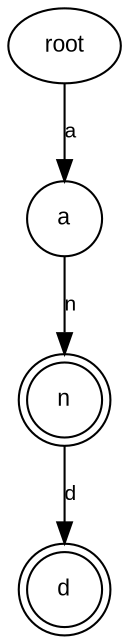
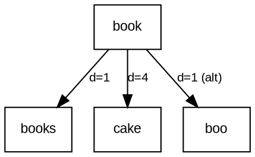

# Decision Matrix & Technical Reference — Diagram Orchestrator

Tài liệu tham chiếu chi tiết hướng dẫn định tuyến và lựa chọn công cụ phù hợp cho từng sơ đồ kỹ thuật.

---

## 1. Ma trận định tuyến chi tiết (Detailed Routing Matrix)

| Loại sơ đồ | Công cụ khuyến nghị | Định dạng nguồn | Renderer | Lý do kỹ thuật cốt lõi |
|---|---|---|---|---|
| **Use Case Diagram** | PlantUML | `.puml` | Kroki / PlantUML | Actor hình người chuẩn ISO/UML 2.x, ranh giới hệ thống, quan hệ `<<include>>`, `<<extend>>`. |
| **Activity Diagram** | PlantUML | `.puml` | Kroki / PlantUML | Cú pháp mới (`start`, `if/else`, `split`, `stop`), luồng rẽ nhánh chuẩn kỹ thuật. |
| **Sequence Diagram** | PlantUML | `.puml` | Kroki / PlantUML | Quản lý lifeline, `activate`/`deactivate`, `alt`/`else`, `autonumber` chính xác. |
| **Class Diagram** | PlantUML | `.puml` | Kroki / PlantUML | Visibility `+`, `-`, `#`, quan hệ composition `*--`, aggregation `o--`, generalization `--\|>`. |
| **State Machine** | PlantUML | `.puml` | Kroki / PlantUML | Trạng thái bắt đầu `[*]`, chuyển trạng thái rõ ràng, ghi chú guard conditions. |
| **ERD (Thực thể quan hệ)** | PlantUML | `.puml` | Kroki / PlantUML | Ký hiệu Crow's foot (`\|\|--o{`), PK/FK rõ ràng, không vẽ đè nhãn lên đường nối. |
| **Prefix Trie** | Graphviz DOT | `.dot` | Kroki / Graphviz | Cấu trúc cây tiền tố với các tầng ký tự phân cấp (`rankdir=TB`), node hình tròn/chữ nhật, đánh dấu ký tự kết thúc. |
| **BK-Tree** | Graphviz DOT | `.dot` | Kroki / Graphviz | Cây tìm kiếm mờ (Fuzzy matching) với trọng số khoảng cách Levenshtein (`label="d=1"`), phân nhánh đa chiều hoàn hảo. |
| **Abstract Syntax Tree (AST)** | Graphviz DOT | `.dot` | Kroki / Graphviz | Biểu diễn cây cú pháp phân tích mã nguồn theo thứ bậc phân cấp tự nhiên. |
| **Đồ thị thuật toán có trọng số** | Graphviz DOT | `.dot` | Kroki / Graphviz | Định vị cạnh có trọng số, thuật toán Dijkstra/A*, cấu trúc nút-cạnh phức tạp. |
| **Kiến trúc tổng quan (High-Level)** | tldraw / draw.io | `.tldr` / `.json` | tldraw-cli / draw.io | Cần phân vùng trực quan (Client, Gateway, Service, Database), bo góc mềm mại, icon hạ tầng. |
| **Sơ đồ triển khai hạ tầng (Deployment)** | PlantUML (nếu UML) hoặc tldraw (nếu trực quan) | `.puml` hoặc `.tldr` | Phù hợp ngữ cảnh | Chọn PlantUML nếu báo cáo chuẩn UML node/artifact; chọn tldraw nếu cần sơ đồ mạng/cloud nhiều vùng trực quan. |

---

## 2. Quy chuẩn cấu trúc dữ liệu: Trie & BK-Tree trong Graphviz

### 2.1. Prefix Trie (Cây tiền tố)
- **Quy tắc:**
  1. Node gốc (Root) thường là ký tự rỗng `ε` hoặc `(root)`.
  2. Mỗi cạnh biểu diễn 1 ký tự tiếp theo.
  3. Node kết thúc từ hợp lệ phải được đánh dấu rõ ràng (ví dụ: `shape=doublecircle`, hoặc có ký tự kết thúc `$`).
  4. Nền trắng `#ffffff`, viền đen `#000000`, nét liền nét mảnh thanh thoát.
- **Mẫu DOT chuẩn Academic Monochrome:**

### 2.2. BK-Tree (Burkhard-Keller Tree cho Fuzzy Search)
- **Quy tắc thuật toán:**
  1. Mỗi node là một từ hoàn chỉnh trong từ điển (ví dụ: `book`, `cake`, `cart`).
  2. Mỗi cạnh từ node cha sang node con mang nhãn là **khoảng cách Levenshtein** (số phép biến đổi tối thiểu: chèn, xóa, thay thế).
  3. **TÍNH NHẤT QUÁN THUẬT TOÁN (BẮT BUỘC):** Không được tự bịa số khoảng cách `d`. Nếu node cha là `book` và con là `books`, khoảng cách bắt buộc phải là `1`. Nếu con là `boo`, khoảng cách là `1`. Nếu con là `back`, khoảng cách là `2`.
  4. Mọi node con của một node cha phải có khoảng cách khác nhau (mỗi khoảng cách `d` chỉ có tối đa một cây con).
- **Mẫu DOT chuẩn Academic Monochrome:**

---

## 3. Quy chuẩn chèn sơ đồ vào DOCX (Word Publication Standard)

1. **Kích thước & Tỷ lệ:**
   - Chiều rộng ảnh chuẩn trang A4 (lề 2.0 - 2.5 cm): `width = Inches(5.8)` đến `Inches(6.2)`.
   - Giữ nguyên tỉ lệ (lock aspect ratio), không kéo dãn méo hình.
2. **Tiêu chuẩn Caption:**
   - Đặt ngay bên dưới ảnh, canh giữa: `Hình X.Y: Tên sơ đồ chi tiết`.
   - Định dạng in nghiêng, cỡ chữ nhỏ hơn 1pt so với văn bản chính (thường 11pt nếu body 12pt).
3. **Phân trang an toàn:**
   - Đặt `paragraph.paragraph_format.keep_with_next = True` trên đoạn văn chứa ảnh để ảnh không bao giờ bị rớt lại trang trước trong khi caption nhảy sang trang sau.
