# Mermaid — Mẫu cú pháp theo từng loại sơ đồ (reference)

## Flowchart (lưu đồ)

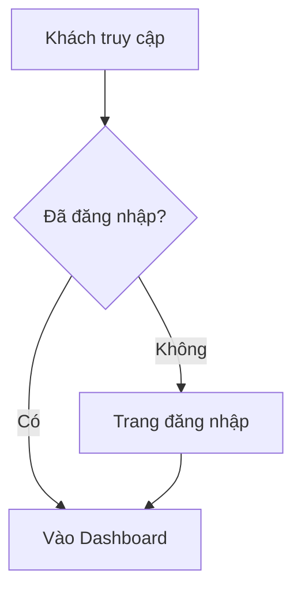

## Sequence (tuần tự)

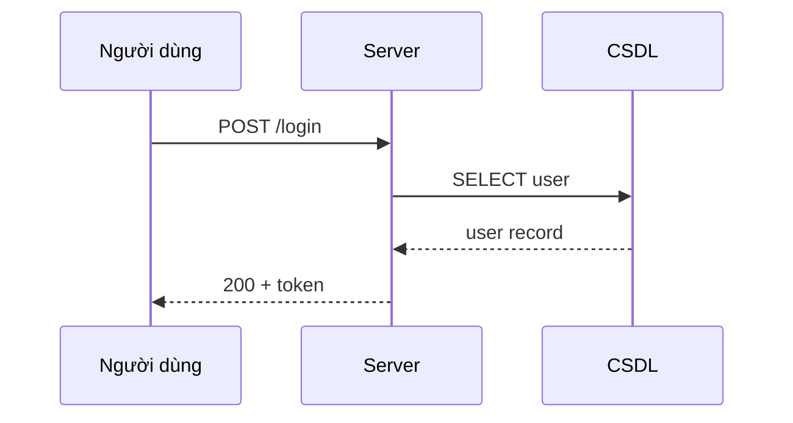

## Class (lớp)

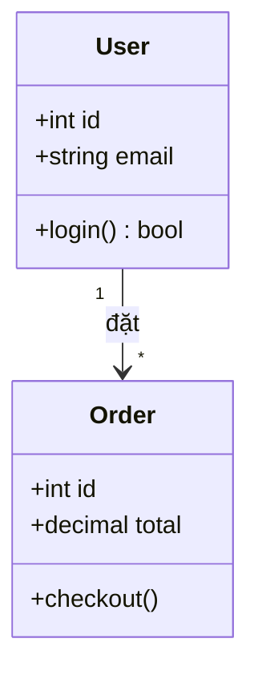

## ER (thực thể - quan hệ)

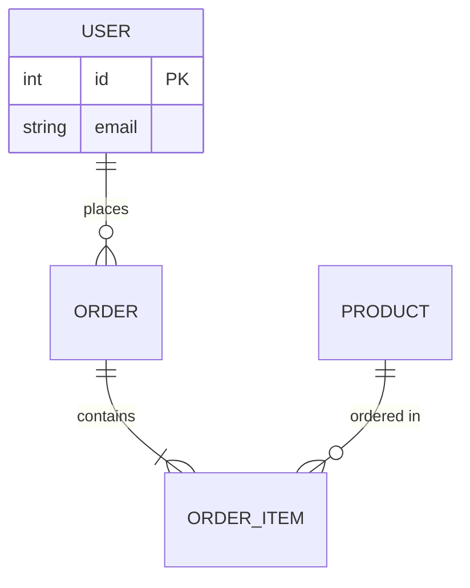

Cardinality crow's-foot: `||--o{` (một tới nhiều tùy chọn), `||--|{` (một tới nhiều bắt buộc).

## State (trạng thái)

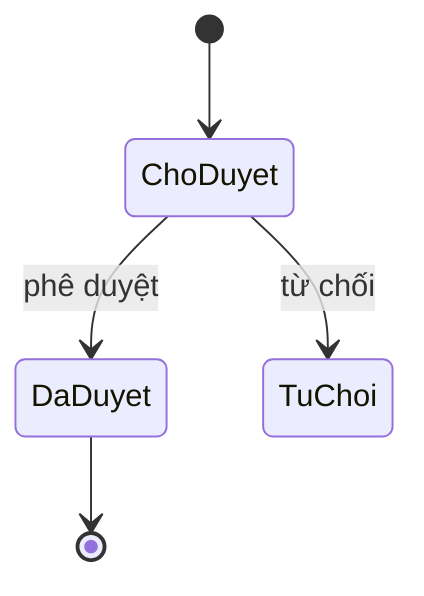

## Activity (gần đúng bằng flowchart)

Mermaid không có "activity diagram" UML riêng; dùng `flowchart` với node tròn/bổ sung:

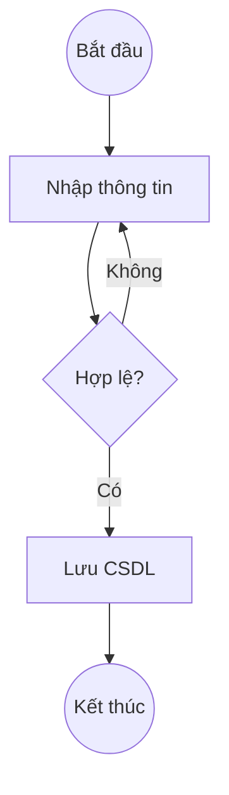

## Use Case

**Ưu tiên PlantUML** cho UML use case chuẩn:

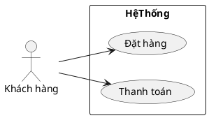

Mermaid có **use-case beta** (≈ v12+):

```mermaid
usecase-beta
    actor KH as "Khách hàng"
    usecase UC1 as "Đặt hàng"
    KH --> UC1
```

## C4 / Kiến trúc

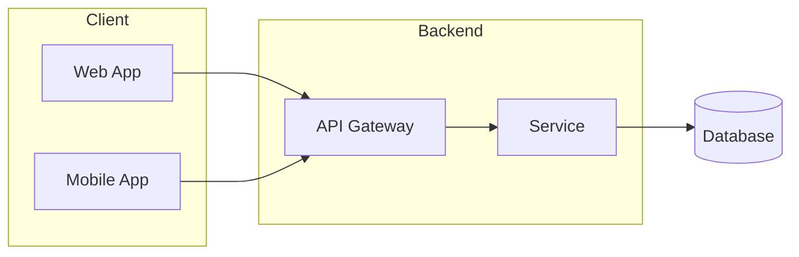

## Gantt

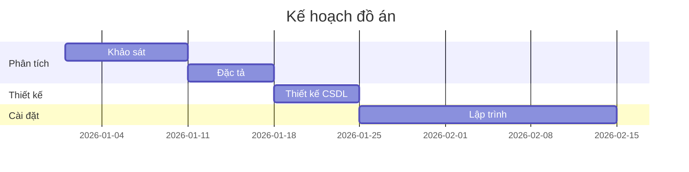

## YAML frontmatter (thay cho %%{init}%% đã deprecated)

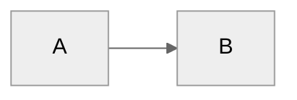

## Accessibility

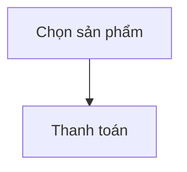
