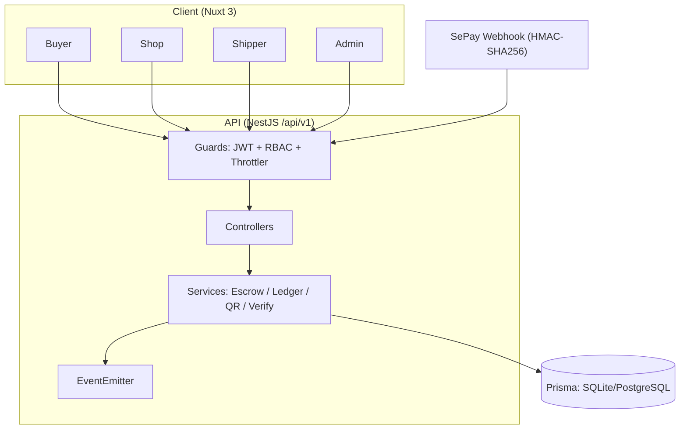
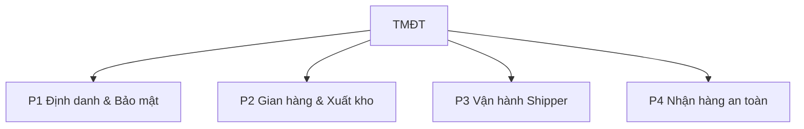
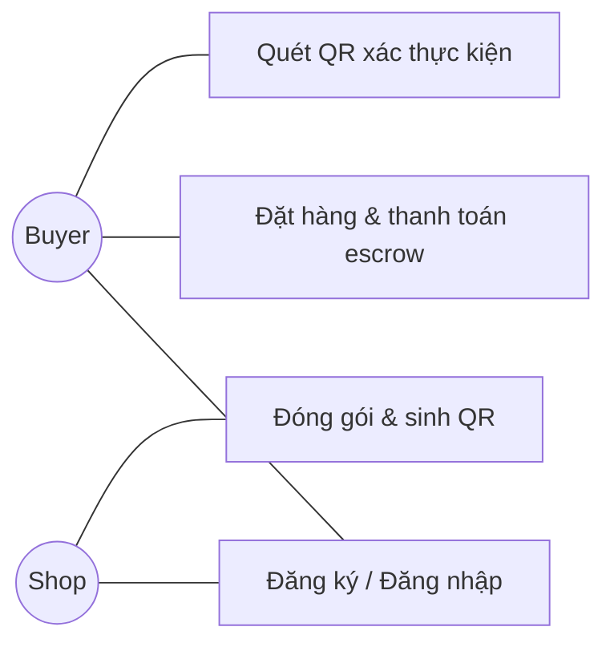
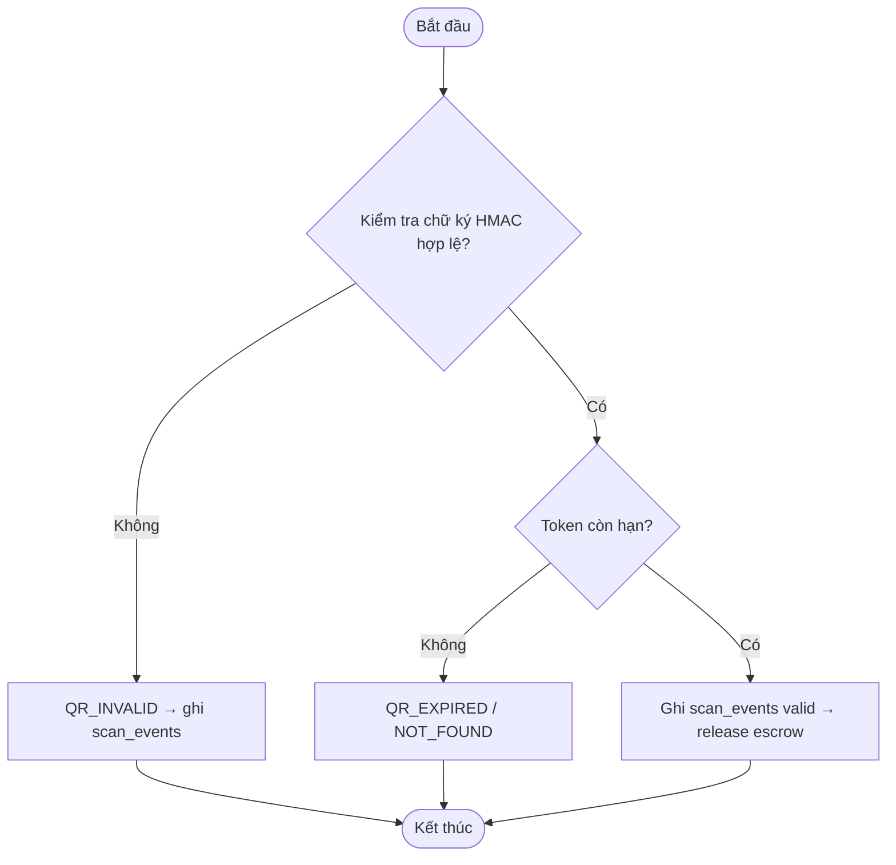
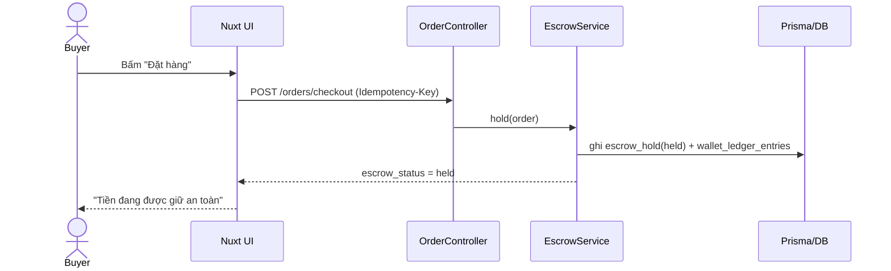
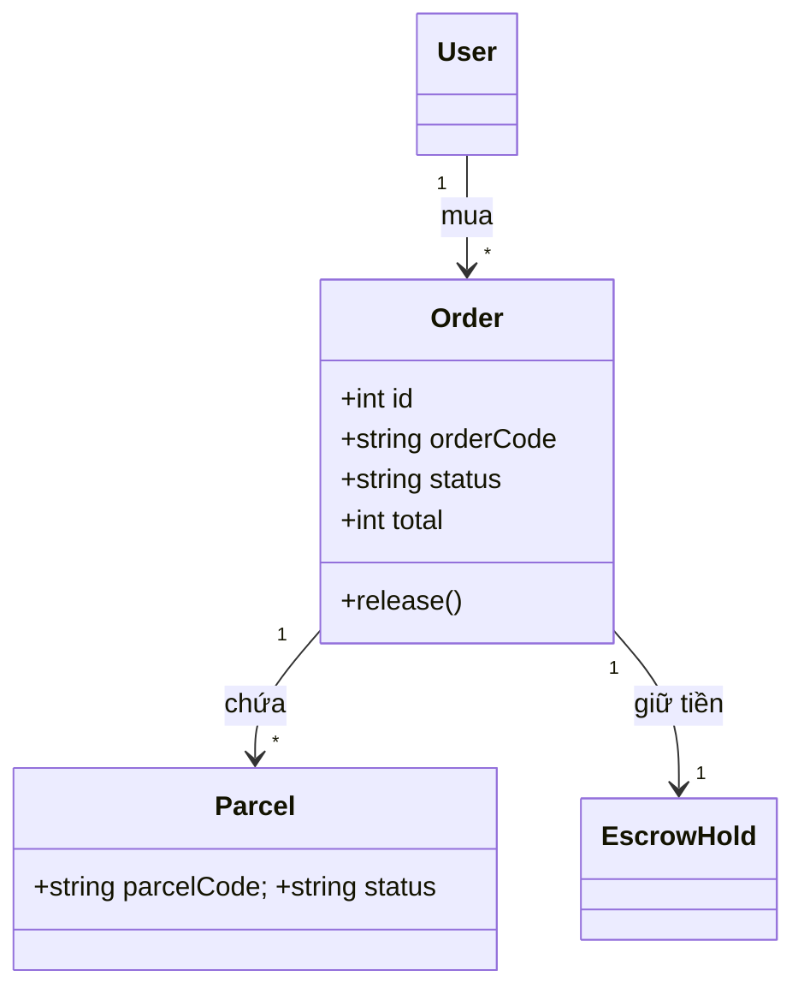
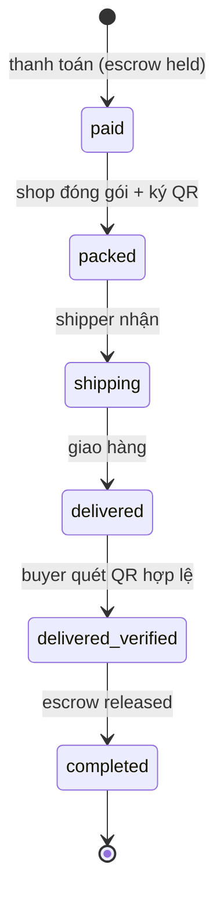
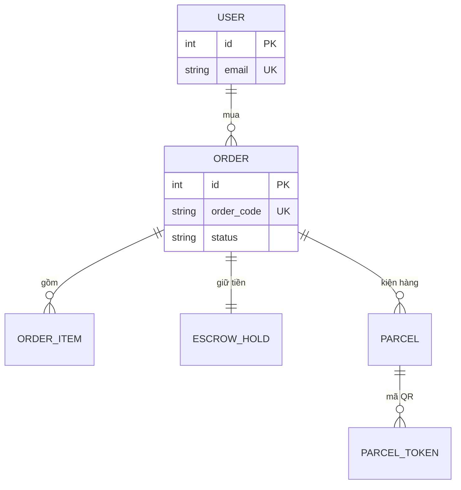

# 08 · Hướng Dẫn Vẽ Sơ Đồ Thiết Kế (Mermaid-first)

> Mục tiêu: chuẩn UML, gọn (lược bỏ chi tiết vụn), nhưng **đúng và đủ** để đọc/hiểu/chấm.
> Dự án đang dùng **Mermaid** (`.mmd` → `svg/`) và **DBML** cho ERD. Giữ đúng hai công cụ này.

---

## 1. Chọn loại sơ đồ theo mục đích

| Cần thể hiện | Loại sơ đồ | Mermaid (`mmd`) | Ghi chú |
|---|---|---|---|
| Tổng thể hệ thống, tầng, luồng phụ thuộc | Kiến trúc (component/C4) | `flowchart TB` | C4: `c4model.com` |
| Chia chức năng thành module P1..Pn | Phân rã chức năng | `flowchart TD` | 1 gốc → nhóm |
| Ai làm được gì | Use Case | `flowchart LR` (actor = `(( ))`) | Mermaid chưa có use-case native |
| Một luồng nghiệp vụ có rẽ nhánh | Activity | `flowchart TD` | `{ }` = quyết định |
| Tương tác giữa các đối tượng theo thời gian | Sequence | `sequenceDiagram` | 1 luồng = 1 sequence |
| Cấu trúc lớp / quan hệ đối tượng | Class | `classDiagram` | chuẩn UML |
| Vòng đời một thực thể (đơn, kiện…) | State Machine | `stateDiagram-v2` | `[*]` = đầu/cuối |
| Lược đồ CSDL | ERD | `erDiagram` (hoặc DBML) | DBML đẹp hơn khi nhiều bảng |

**Quy tắc vàng:** một sơ đồ = một câu hỏi. Đừng nhồi 3 luồng vào 1 sequence; tách file.

---

## 2. Bộ khung tối giản (copy–paste)

### 2.1 Kiến trúc — `flowchart TB`


### 2.2 Phân rã chức năng — `flowchart TD`


### 2.3 Use Case — `flowchart LR` (actor = hình tròn)

> Không vẽ mọi actor × mọi UC cho rối. Chỉ nối actor–UC **thực sự có**.

### 2.4 Activity — `flowchart TD` (`{ }` = quyết định, `([ ])` = đầu/cuối)


### 2.5 Sequence — `sequenceDiagram`

Ký hiệu: `->>` gọi (solid) · `-->>` trả về (dashed) · `-)` async · `Note over` chú thích · `alt/else/end` rẽ nhánh.

### 2.6 Class — `classDiagram`


### 2.7 State Machine — `stateDiagram-v2`


### 2.8 ERD — `erDiagram`

> Nhiều bảng (>12) → dùng **DBML** (dbdiagram.io) cho gọn và đẹp, xem `CHO_AGENT_DEV/03_ERD_SCHEMA.dbml`.

---

## 3. Ký hiệu UML chuẩn (nhớ bảng này là đủ)

**Class / quan hệ**
| Ký hiệu | Ý nghĩa |
|---|---|
| `A <|-- B` | Kế thừa (B kế thừa A) |
| `A ..|> I` | Thực thi interface |
| `A *-- B` | Composition (thành phần sở hữu) |
| `A o-- B` | Aggregation (tập hợp lỏng) |
| `A --> B` | Association (kết hợp) |
| `A ..> B` | Dependency |
| `"1" -- "*"` | Bội số (multiplicity) |

**ERD (cardinality chân vịt)**: `||` = 1 · `o` = 0 · `|` = bắt buộc · `{` / `}` = many.
Ví dụ `USER ||--o{ ORDER` = 1 user có 0..n order.

**Sequence**: `->>` đồng bộ · `-->>` trả về · `-)` bất đồng bộ · `alt/opt/loop` = khung điều kiện · `activate/deactivate` = thanh kích hoạt.

---

## 4. Quy ước & cách "lược bỏ đúng đủ"

**Nên làm**
- Mỗi sơ đồ một khía cạnh; ≤ ~12 nhánh/node cho dễ đọc.
- Tên ngắn gọn, tiếng Việt có dấu; mã kỹ thuật (`order_status`, `QR_INVALID`) giữ nguyên.
- Chỉ vẽ **thuộc tính khóa** trong class/ERD; chi tiết để trong docs/DBML.
- Đặt tên file: `NN-ten-khong-dau.mmd` (vd `05-sequence-mua-hang-escrow.mmd`).

**Tránh (lược bỏ)**
- Không liệt kê mọi getter/setter, mọi cột — chỉ field nghiệp vụ chính.
- Không vẽ mọi exception/nhánh phụ trong 1 activity — tách nếu cần.
- Không trộn client + DB + API vào 1 sequence khổng lồ.
- Không dùng màu mè thừa; giữ `skinparam`/theme tối giản, thống nhất toàn bộ file.

---

## 5. Render `.mmd` → SVG (đang có sẵn trong `docs/diagrams/svg/`)

**Cách 1 — Mermaid CLI (offline, cần Node):**
```bash
npx -y @mermaid-js/mermaid-cli -i docs/diagrams/05-sequence-mua-hang-escrow.mmd \
  -o docs/diagrams/svg/05-sequence-mua-hang-escrow.svg
```

**Cách 2 — Kroki (không cài gì, có mạng):** POST nội dung file tới
`https://kroki.io/mermaid/svg` → nhận SVG/PNG.

**Cách 3 — Xem nhanh:** dán vào https://mermaid.live (preview + export PNG/SVG).

> DBML: dán vào https://dbdiagram.io để export ảnh.

---

## 6. Checklist trước khi nộp một sơ đồ

- [ ] Đúng loại sơ đồ với đúng câu hỏi cần trả lời.
- [ ] Có tiêu đề/ngữ cảnh; tên file theo quy ước `NN-ten.mmd`.
- [ ] Ký hiệu UML đúng (kế thừa/composition/multiplicity/cardinality).
- [ ] Không quá tải; đã lược bỏ chi tiết vụn.
- [ ] Đã render ra `svg/` và nhúng vào báo cáo bằng ảnh (không dán text).
- [ ] Nhất quán tên gọi với `DATABASE_BLUEPRINT` / `API_CONTRACTS`.

---

## 7. Nguồn tham khảo (repo / skill)

**Skill (định dạng Agent Skills — cài được)**
- `markdown-viewer/skills` → `uml/SKILL.md`: skill UML/PlantUML đầy đủ, có file tham chiếu cho từng loại sơ đồ.
- `fa-ina-tic/plantuml-skill`: biến mô tả → `.puml`, render PNG/SVG qua Kroki (không cần Java).
- `SpillwaveSolutions/plantuml`: skill PlantUML + ví dụ theo loại app (Spring/FastAPI/Node/React).

**Repo ví dụ (copy mẫu)**
- `capablesoft/diagram-examples`: mẫu 15 ngôn ngữ (Mermaid, PlantUML, DBML, C4, D2, Graphviz…).
- `joelparkerhenderson/plantuml-examples`: kho PlantUML đồ sộ (UML, ERD, C4, wireframe…).
- `Seekatar/plantuml-mermaid`: so sánh PlantUML vs Mermaid + mẫu.

**Danh sách chọn công cụ**
- `awesome-diagramming` (Wolfsrudel / generalistprogrammer): tool diagram-as-code, có tiêu chí chọn.
- `akondratsky/text-to-diagram-tools`: so sánh chi tiết D2 / PlantUML / Mermaid / Graphviz.

**Tài liệu chính thức**
- Mermaid: https://mermaid.js.org · Editor: https://mermaid.live
- PlantUML: https://plantuml.com
- C4 model: https://c4model.com
- DBML / dbdiagram: https://dbml.dbdiagram.io · Kroki: https://kroki.io

> Khuyến nghị cho dự án này: **giữ Mermaid** (đúng như bộ `.mmd` hiện có) cho kiến trúc/activity/sequence/class/state/use-case; dùng **DBML** cho ERD; render bằng Mermaid CLI hoặc Kroki.
