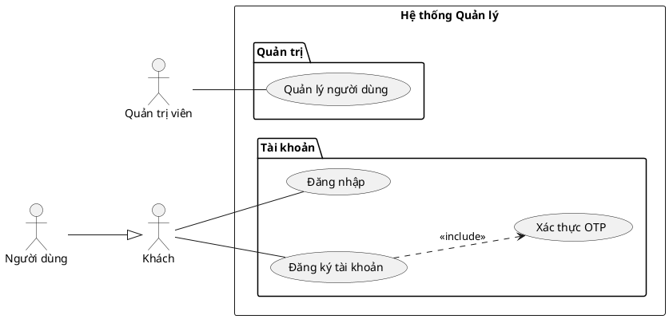
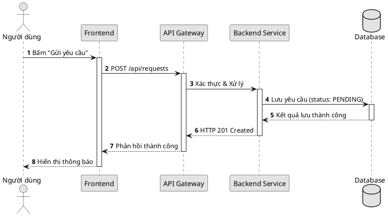
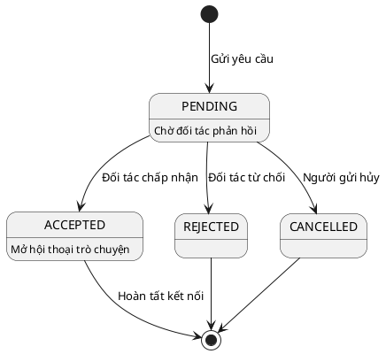
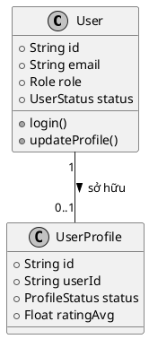

# PlantUML Diagrams Skill — Chuẩn mực UML Tuyệt đối cho Báo cáo & Luận văn

Mục tiêu: Tạo sơ đồ kỹ thuật **đúng 100% chuẩn quy ước UML 2.x / ISO**, **luôn luôn màu Trắng - Đen (B&W)**, khắc phục triệt để các nhược điểm của Mermaid (vẽ xấu, gãy góc, sai ký hiệu Use Case/UML).

---

## 0. LUẬT BẤT BIẾN: KHÔNG MÀU TUYỆT ĐỐI (ZERO-COLOR DOCTRINE) — ÁP DỤNG KỂ CẢ KHI ẢNH MẪU CÓ MÀU

> [!CAUTION]
> **ẢNH MẪU NHIỀU MÀU KHÔNG PHẢI LÀ LỆNH CẤP PHÉP DÙNG MÀU.**
> Khi người dùng gửi một sơ đồ mẫu nhiều màu (Lucidchart, draw.io, Visual Paradigm, DayNhauHoc…) và nói *"vẽ giống hình này"*, Agent **CHỈ ĐƯỢC SAO CHÉP**: cấu trúc, bố cục, nhóm module, quan hệ, hướng luồng, mức trừu tượng.
> Agent **TUYỆT ĐỐI KHÔNG ĐƯỢC SAO CHÉP MÀU SẮC**. Mọi nhóm màu trong ảnh mẫu (xanh/vàng/hồng/tím/xám…) phải được **dịch sang kênh phi màu**:
> - Nhóm module → dùng `package` / `rectangle` bao quanh.
> - Phân biệt nhánh → nét liền / nét đứt / nét dày mỏng.
> - Phân loại thành phần → `<<stereotype>>`, chữ **đậm** / *nghiêng*.
> - Trạng thái đặc biệt → hình dạng khác (elip, double-circle, ghi chú `note`).
> Lý do: màu mè phá vỡ tính trang nghiêm của báo cáo kỹ thuật, hao mực khi in, và không nhất quán thị giác giữa các hình trong cùng một đồ án.

### 0.1. Danh mục CẤM TUYỆT ĐỐI (Hard Prohibitions)
1. **CẤM** `skinparam monochrome false` và mọi cách bật lại màu.
2. **CẤM** mọi mã màu KHÔNG thuộc thang độ xám trong `skinparam`, `usecase "x" as y #COLOR`, `rectangle #COLOR`, `note #COLOR`, `legend`, `state ... #COLOR`, `partition #COLOR`.
3. **CẤM** `!theme` có màu (chỉ dùng theme monochrome thuần).
4. **CẤM** `skinparam BackgroundColor` khác `#FFFFFF` (hoặc bỏ trống); **CẤM** `skinparam shadowing true`.
5. **CẤM** nền tô đậm màu (`#FFE082`, `#A5D6A7`, `#CE93D8`, `#EF9A9A`…) — đây là lỗi copy màu từ ảnh mẫu thường gặp nhất.

### 0.2. Bảng màu DUY NHẤT được phép (Grayscale Whitelist)
| Vai trò | Mã cho phép |
| :--- | :--- |
| Nền | `#FFFFFF` hoặc `none`/bỏ trống |
| Viền & chữ | `#000000` (khuyến nghị) hoặc `#1A1A1A`, `#333333` |
| Tô nhạt phân tầng (tùy chọn) | `#F1F1F1`, `#E3E3E3`, `#C2C2C2`, `#CCCCCC`, `#E6E6E6` |
| Đường nét phụ | `#888888`, `#666666`, `#000000` |
Quy tắc kiểm: một mã màu hợp lệ khi `max(R,G,B) - min(R,G,B) ≤ 12`. Vượt ngưỡng này = **vi phạm luật zero-color**.

### 0.3. Khi người dùng cố tình ép dùng màu
Nếu người dùng nài nỉ dùng màu, Agent **ghi rõ một câu**: *"Theo luật dự án, sơ đồ báo cáo dùng Trắng-Đen học thuật; tôi giữ B&W."* và **vẫn xuất B&W**. Chỉ chuyển sang màu khi người dùng gõ một lệnh ghi đè tường minh dạng `override-monochrome: true` (và việc đó phải được ghi lại trong báo cáo nghiệm thu).

---

## Vì sao PlantUML thay thế hoàn toàn Mermaid?

| Tiêu chí | Mermaid | PlantUML (`plantuml-diagrams`) |
| :--- | :--- | :--- |
| **Sơ đồ Use Case** | Dùng flowchart giả lập, node tròn, mũi tên sai chuẩn | **Hình người (`actor`), elip chuẩn, ranh giới hệ thống, `<<include>>`, generalization chính xác** |
| **Sơ đồ Tuần tự (Sequence)** | Căn chỉnh thô, khó phân nhóm alt/opt phức tạp | **Rõ ràng, thanh kích hoạt (`activate`), lifeline, note, loop, alt/opt chuẩn UML** |
| **Sơ đồ Lớp & ERD** | Khối chữ nhật thô, hiển thị quan hệ hạn chế | **Hiển thị đầy đủ field, method, visibility (`+`, `-`, `#`), quan hệ composition, aggregation** |
| **Thẩm mỹ in ấn** | Hay bị lỗi font tiếng Việt, màu mè không hợp học thuật | **Trắng - đen tối giản (`skinparam monochrome true`), tương phản cao, nét in ấn hoàn hảo** |

---

## 1. QUY TẮC THẨM MỸ: CHUẨN GIÁO TRÌNH HỌC THUẬT & LUCIDCHART MONOCHROME

Mọi sơ đồ PlantUML sinh ra cho báo cáo/đồ án bắt buộc tuân thủ bộ quy chuẩn thị giác (Visual Standards) chuẩn mực như Lucidchart, Visual Paradigm và giáo trình ĐH:

```plantuml
skinparam monochrome true
skinparam shadowing false
skinparam defaultFontName "Segoe UI", Arial, sans-serif
skinparam defaultFontSize 12
skinparam classFontSize 13
skinparam classAttributeFontSize 11
skinparam classAttributeIconSize 0    ' BẮT BUỘC: Dùng ký tự text +, -, # thay vì icon tròn màu
skinparam roundCorner 0               ' Hộp vuông vức sắc nét chuẩn mực giáo trình
skinparam dpi 300
skinparam linetype ortho              ' Đường nối vuông góc 90 độ tuyệt đối, không xiên vẹo
skinparam nodesep 70                  ' Giãn cách ngang rộng rãi, chữ không đè lên nhau
skinparam ranksep 70                  ' Giãn cách dọc thoáng đãng
```

### Các nguyên tắc vàng (Golden Rules):
1. **TUYỆT ĐỐI CẤM DÙNG `title` TRONG FILE PUML:** Tiêu đề sơ đồ luôn nằm ở dòng Caption tài liệu (`Hình 3.1: ...`). Nhúng `title` vào ảnh làm thừa diện tích và lặp chữ.
2. **`classAttributeIconSize 0`:** Hiển thị rõ ràng các ký hiệu phạm vi truy cập `+` (public), `-` (private), `#` (protected) theo chuẩn ISO/UML 2.x, không dùng icon hình tròn.
3. **Đường nối vuông góc 90° (`linetype ortho`):** Mọi dây nối gập góc vuông dứt khoát, không đi chéo ngang mặt class khác.
4. **Khoảng cách thở (Breathing Room):** `nodesep 70` và `ranksep 70` đảm bảo nhãn số lượng (`1`, `0..*`) và tên quan hệ luôn tách bạch, không bao giờ dính chữ.
5. **Cấm tiệt `skinparam handwritten true`:** Nét sketch méo mó và sinh banner cảnh báo làm mất tính trang nghiêm của báo cáo kỹ thuật.
6. **Chống nhồi nhét tương tác vào sơ đồ tầng (Inter-tier Anti-Crowding):** Trong sơ đồ kiến trúc phân tầng/khối, cấm chèn dày đặc nhãn thao tác CRUD, tìm kiếm, import/export lên đường nối. Chỉ vẽ khối và mũi tên phụ thuộc; chi tiết tương tác bắt buộc chuyển sang Sequence Diagram.
7. **Cẩn trọng với nhãn cạnh khi bật `linetype ortho`:** Graphviz `dot` engine chưa xử lý hoàn chỉnh việc tính toán vị trí nhãn cạnh khi dùng đường trực giao (`ortho`), rất dễ thả nhãn vào trung điểm và đè bẹp lên đường viền package (`cluster`). Khi gặp lỗi này: ưu tiên rút ngắn nhãn, thử `xlabel`, hoặc chuyển mô tả sang component/note tương ứng. Tuyệt đối không tùy tiện xóa bỏ package lồng nhau hay đảo lộn cấu trúc tổng thể khi chưa cô lập biến thử nghiệm (Single-Variable Isolation).

---

## 1.1. QUY CHUẨN BỐ CỤC ĐẸP — TIÊU CHÍ ĐO ĐƯỢC (LAYOUT BEAUTY ACCEPTANCE)

> [!IMPORTANT]
> "Đẹp" không phải cảm tính. Mỗi sơ đồ phải vượt qua bảng ngưỡng định lượng sau **trước khi** được coi là hoàn thiện:

| # | Tiêu chí bố cục | Ngưỡng BẮT BUỘC | Cách kiểm |
| :-: | :--- | :--- | :--- |
| 1 | Số khối/node trung tâm mỗi hàng | 3–5 | Đếm trực quan |
| 2 | Số khối/node trung tâm mỗi cột | 3–6 | Đếm trực quan |
| 3 | Tổng node/hình | ≤ 15; **> 15 bắt buộc phân rã** | Đếm trực quan |
| 4 | Khoảng cách ngang giữa node (`nodesep`) | 60–80 | `skinparam nodesep` |
| 5 | Khoảng cách dọc giữa tầng (`ranksep`) | 60–90 | `skinparam ranksep` |
| 6 | Cỡ chữ nhỏ nhất khi in A4 | ≥ 9pt | `font-size` trong SVG |
| 7 | Tỷ lệ khung hình | 0.5 ≤ ratio ≤ 2.4 (lý tưởng 4:3–16:9) | `viewBox` |
| 8 | Độ lệch trọng tâm khối so với tâm khung | ≤ 20% mỗi trục | Ước lượng thị giác |
| 9 | Cụm dồn cục | Cấm ≥ 3 node cách nhau < 30px | Soi ảnh |
| 10 | Nhãn cạnh | ≤ 25 ký tự, không chồng nhãn khác | Soi ảnh |
| 11 | Đường nối | Không cắt xuyên node khác / không cắt chữ | Soi ảnh |
| 12 | Node mồ côi / trùng chồng | **Cấm** node rời không liên kết, node đè node | Soi ảnh |
| 13 | Cân đối khoảng trắng | Không để trống hoác nửa hình, không dồn cục nửa còn lại | Soi ảnh |

### Quy trình LÀM ĐẸP 3 VÒNG BẮT BUỘC (Beautify Loop)
1. **Vòng 1 — Dựng:** Tạo `.puml` từ cấu trúc đúng ngữ nghĩa trước, chưa cần đẹp.
2. **Vòng 2 — Render + Soi:** Render PNG, **mở ảnh trực tiếp vào ngữ cảnh model**, chấm theo 13 tiêu chí trên. **Chỉ sửa MỘT biến số mỗi vòng** (Single-Variable Isolation), rồi render lại và soi lại.
3. **Vòng 3 — Chuẩn hoá:** Căn lại khoảng thở (`nodesep`/`ranksep`), cân nhóm, rút gọn nhãn, xoá node mồ côi; render lại và soi lại.
> Không được tuyên bố hoàn thiện nếu **chưa thực hiện tối thiểu 1 vòng render→soi→sửa→render→soi** có bằng chứng.

---

## 1.2. PLAYBOOK VẼ USE CASE (BƯỚC 0 → BƯỚC 4) & KỶ LUẬT THÉP

> [!CAUTION]
> **LUẬT CHẶN CỨNG: KHÔNG XÁC ĐỊNH BÀI TOÁN THÌ CẤM VẼ.**
> Vẽ Use Case mà chưa hiểu hệ thống giải quyết bài toán gì, có bao nhiêu người vận hành, mỗi tác nhân chịu trách nhiệm gì → đó là **lỗi tư duy nghiêm trọng**, KHÔNG phải lỗi bố cục. Sơ đồ sinh ra sẽ sai ngay từ gốc và mọi nỗ lực căn lề đều vô nghĩa.

### BƯỚC 0 — XÁC ĐỊNH BÀI TOÁN, QUY MÔ & VAI TRÒ TÁC NHÂN (BẮT BUỘC, XUẤT FILE MD TRƯỚC KHI VẼ)
Trước khi viết một dòng `.puml`, Agent **BẮT BUỘC** tạo một file Markdown (theo mẫu [`diagram-orchestrator/reference/step0-bai-toan-va-tac-nhan.md`](file:///E:/HOC%20TAP/my-project/sp-agent/.claude/skills/diagram-orchestrator/reference/step0-bai-toan-va-tac-nhan.md)) và trả lời **đủ** các câu hỏi:
1. **Bài toán là gì?** Hệ thống giải quyết vấn đề gì, cho ai, thay thế/đang làm gì hiện tại?
2. **Quy mô:** bao nhiêu người vận hành, bao nhiêu tác nhân, tần suất, khối lượng?
3. **Mỗi tác nhân làm gì?** Liệt kê từng vai trò + trách nhiệm cụ thể. Phân biệt rõ:
   - **Ai sửa lỗi kỹ thuật (IT)** vs **ai KHÔNG sửa lỗi IT nhưng chịu trách nhiệm nghiệp vụ** — tách bạch theo đúng yêu cầu, không gộp một tác nhân làm cả hai nếu tài liệu không nói vậy.
   - Từng vai trò nội bộ chịu trách nhiệm gì (quản trị, vận hành, kiểm duyệt/duyệt, xử lý lỗi…) — **bám yêu cầu, không bịa**.
   - Từng vai trò người dùng/bên ngoài làm gì; khách chưa đăng nhập làm được gì.
4. **Ranh giới hệ thống:** cái gì nằm trong, cái gì nằm ngoài (các dịch vụ/hệ thống ngoài là tác nhân phụ, ví dụ một dịch vụ mail/thông báo nào đó của dự án).
5. **Quan hệ thật sự cần:** chỉ vẽ `<<include>>` / `<<extend>>` / kế thừa khi **thực sự đúng bản chất** — không vẽ cho "đủ bộ".
6. **Kiểu sơ đồ & mức trừu tượng:** 1 hình tổng quan hay phân rã nhiều hình (nếu > 15 use case → phân rã).
7. **BẰNG CHỨNG BẮT BUỘC (không phải thủ tục hình thức):** mỗi trách nhiệm tác nhân phải trỏ tới nguồn thực (`[REQ-xx]`, `[BRD §x.y]`, `[SRS §x.y]`, `[code: <file>:<line>]`, `[user-confirmed YYYY-MM-DD]`). Chỗ **chưa rõ ghi `UNKNOWN`** — tuyệt đối **không tự suy diễn**. Nếu `UNKNOWN` ảnh hưởng cao (làm đổi tác nhân / ranh giới / quan hệ) → **DỪNG, hỏi người dùng, cấm vẽ mặc định**. Chi tiết: Phụ lục A (Kỷ luật bằng chứng) của template Bước 0.

### BƯỚC 1 — CHỐT NGHIỆP VỤ
Từ file Bước 0, chốt: tác nhân, mục tiêu từng tác nhân, ranh giới hệ thống, quan hệ include/extend/kế thừa nếu thực sự cần. Loại bỏ thao tác UI vụn vặt (nhấn nút, nhập text) — chúng không phải Use Case.

### BƯỚC 2 — PHÂN VÙNG BỐ CỤC
Chia use case theo **nhóm chức năng** (dùng `package`), dịch nhóm màu của ảnh mẫu sang kênh phi màu (§0). Bố trí tác nhân **hai bên** hoặc theo nhóm phù hợp luồng nghiệp vụ: tác nhân chính bên trái, tác nhân phụ/hệ thống ngoài bên phải. **Không ép mọi tác nhân đứng chung một phía.**

### BƯỚC 3 — TỐI ƯU ĐƯỜNG NỐI
Hạn chế giao cắt; **cấm đường nối xuyên qua ellipse**; đặt nhãn quan hệ gần đường tương ứng; giữ khoảng cách `nodesep`/`ranksep` hợp lý; rút nhãn ≤ 25 ký tự. Kiểm bằng 13 tiêu chí §1.1.

### BƯỚC 4 — KIỂM TRA ĐẦU RA (A4) — CẤU HÌNH KHÔNG PHẢI BẰNG CHỨNG
> [!IMPORTANT]
> Chỉ đặt `package`, `nodesep`, `ranksep` **KHÔNG** đảm bảo hết giao cắt. Bố cục chỉ được coi là "đã kiểm chứng" khi có **cả 4 việc**:
> 1. **Render thật** ra PNG **và** SVG (không đoán từ mã nguồn).
> 2. **Kiểm kích thước** file SVG/PNG: > 500 bytes, tỷ lệ khung 0.5–2.4.
> 3. **Soi ảnh PNG trực tiếp vào ngữ cảnh model** (Proof-of-View §2 của `diagram-auditor`) ở **tỷ lệ trang A4 (~15cm)**: chữ không bị cắt, tác nhân không chồng lên đường biên hệ thống, đường nối không quá dài, không giao cắt xuyên ellipse, vẫn đọc được khi chèn vào Word.
> 4. **Chạy audit tự động:** `node .claude/skills/diagram-auditor/scripts/audit-diagrams.mjs <thư-mục>` — 0 lỗi ĐỎ; cảnh báo VÀNG phải tự phân xử.
> Nếu bước 3 hoặc 4 chưa chạy → KHÔNG được tuyên bố hoàn thiện, dù mã nguồn trông đã "sạch".

### LỖI THƯỜNG GẶP KHI VẼ USE CASE (PITFALL → FIX)
| Lỗi đã gặp | Cách sửa |
| :--- | :--- |
| Vẽ khi **chưa xác định tác nhân/nghiệp vụ** | Chốt Bước 0 (bài toán + tác nhân + trách nhiệm) **trước** |
| Biến một **phương thức/cơ chế** (cổng thanh toán, dịch vụ gửi mail…) thành **tác nhân chính** | Chỉ là tác nhân nếu nó **thực sự tương tác qua ranh giới hệ thống**; nếu chỉ là cơ chế bên trong → **gộp vào use case**, hoặc để là tác nhân phụ `<<Secondary>>` |
| **Dồn hết tác nhân về một phía** | Bố trí **2 bên**: người dùng **trái**, vận hành/hệ thống ngoài **phải** |
| Đường nối **xuyên qua ellipse**, nhiều giao cắt | Mỗi tác nhân nối **cột use case cạnh nó** (đường ngắn); include/extend đi sang phải và **gập vuông** |
| Nhiều **nhánh include/extend chồng lên nhau** | Đặt use case nguồn ở **các độ cao khác nhau** để nhánh tách hẳn |
| Kỳ vọng **PlantUML ghim vị trí** tuyệt đối | PlantUML **KHÔNG kiểm soát được vị trí** từng phần tử (dễ tự dồn tác nhân). Cần bố cục tay → chuyển **draw.io / tldraw / SVG** |
| Connector **vòng xa** (dài ngoằng vòng qua mép canvas rồi quay lại) | Đây là **lỗi BỐ CỤC**, không phải lỗi nét vẽ → **di chuyển node** (đưa use case nguồn/đích lại gần nhau), **KHÔNG kéo dây vòng**. Chi tiết & luật cứng: skill `use-case-layout` §3.5 |

### KỶ LUẬT THÉP — TỰ TỐ CÁO KHI VI PHẠM (IRON DISCIPLINE)
- Nếu Agent (hoặc bất kỳ lượt nào) **vẽ Use Case khi chưa có file Bước 0**, đó là **VI PHẠM KỶ LUẬT**. Agent **BẮT BUỘC**:
  1. Phát tín hiệu vi phạm nguyên văn: `⚠️ VI PHẠM KỶ LUẬT: chưa xác định bài toán/tác nhân (thiếu Bước 0).`
  2. **DỪNG**, không căn chỉnh vẻ đẹp trên nền sai.
  3. Làm lại từ Bước 0, rồi mới vẽ lại.
- Người kiểm định (Adversarial Reviewer) **phải bác bỏ (FAIL)** mọi sản phẩm thiếu Bước 0, và nói thẳng bản chất lỗi: *"đây là lỗi tư duy mô hình hóa, không phải lỗi bố cục."* Tuyệt đối **không tự tha thứ, không nể nang**, không được gộp chung vào một chữ PASS.

### NGUYÊN TẮC CHỐT (BẤT DI BẤT DỊCH)
> 1. **Không có Bước 0 đã XÁC MINH bằng bằng chứng → KHÔNG VẼ.**
> 2. **Có Bước 0 nhưng mô hình SAI → KHÔNG được căn chỉnh bố cục để che lỗi.** Phải sửa mô hình trước.
> 3. **Mô hình ĐÚNG nhưng hình KHÓ ĐỌC → tiếp tục tối ưu bố cục và kiểm tra lại** (lặp render → soi → sửa → audit) cho tới khi đạt.
> **Thứ tự bất biến: Nghiệp vụ (đúng/sai) trước → Thị giác (đẹp/xấu) sau.** Không bao giờ đảo. Hai cổng phán độc lập: **Semantic Review** phán nghiệp vụ/UML, **Visual Review** phán hình học — thiếu Bước 0 là FAIL nghiệp vụ dù hình có đẹp tới đâu.

---

## 2. Các loại sơ đồ hỗ trợ & Cú pháp mẫu

### 2.1. Use Case Diagram (Chuẩn mực)
> **Lưu ý zero-color:** Nếu ảnh mẫu của người dùng nhóm các Use Case bằng MÀU, ta dịch nhóm đó thành `package` bao quanh (kênh phi màu) — xem §0.


### 2.2. Sequence Diagram (Sơ đồ tuần tự)


### 2.3. State Diagram (Vòng đời trạng thái)


### 2.4. Class Diagram & ERD


---

## 3. Cách Render ra SVG & PNG

Sử dụng script tích hợp của skill:
```bash
# Render 1 file .puml ra cả .svg và .png (tự động)
node .claude/skills/plantuml-diagrams/scripts/render-puml.mjs --in diagram.puml
```

Output:
- `diagram.svg`: Dùng chèn vào Word (`docx-report`), PDF vector nét căng.
- `diagram.png`: Dùng dán vào Slide (`pptx-deck`), ảnh nét 2x.

---

## 4. Quy tắc QA cho Agent

1. **Kiểm tra cú pháp PlantUML:** Đảm bảo cặp `@startuml` và `@enduml`, không dùng từ khóa lạ phá vỡ ngữ pháp.
2. **Kiểm tra zero-color:** Quét file `.puml` — nếu tồn tại mã màu KHÔNG thuộc thang độ xám (§0.2) → **sửa ngay về B&W trước khi render**. Đây là lỗi chặn cứng (hard-block).
3. **Kiểm tra tác nhân:** 
   - Tác nhân chính (Primary Actors) luôn đặt bên trái (`left to right direction`).
   - Tác nhân phụ (Secondary / External Services) luôn đặt bên phải và gắn stereotype `<< Secondary >>`.
3. **Kiểm tra đường liên kết:**
   - Liên kết giữa Actor và Use Case luôn dùng nét thẳng `--`, **không dùng mũi tên** (Association chuẩn).
   - Kế thừa tác nhân dùng mũi tên tam giác rỗng `--|>`.
   - Quan hệ `<<include>>` và `<<extend>>` dùng nét đứt `..>`.
4. **Nhúng tài liệu:** Luôn cập nhật caption dưới hình: `Hình X.Y: <Tên sơ đồ>`.
5. **Bàn giao trực quan sạch (Zero Code Dumps):** Sau khi tạo mã và render thành công, trong phản hồi cho người dùng **CHỈ hiển thị ảnh trực quan** (``), tiêu đề `Hình X.Y: <Tên sơ đồ>`, và link dẫn đến file `.puml`. **TUYỆT ĐỐI CẤM** in/xổ toàn bộ code block `@startuml ... @enduml` ra khung chat làm rối giao diện.

---

## 5. FALLBACK — Khi công cụ KHÔNG vẽ được: VẼ TAY nhưng BẮT BUỘC theo chuẩn

PlantUML/Mermaid **không kiểm soát được vị trí phần tử**. Với **Use Case nhiều actor**, chúng tự dồn actor xuống đáy và kéo đường nối chằng chịt — SAI bố cục. Khi gặp, agent **được phép vẽ tay (SVG) hoặc xuất `.drawio`**, NHƯNG phải tuân thủ **NGHIÊM** chuẩn UML Use Case dưới đây. **TUYỆT ĐỐI KHÔNG tự do vẽ Use Case sai.**

### 5.1 Ngưỡng chuyển sang vẽ tay
- Số **actor người dùng ≥ 3** HOẶC tổng **use case > 12**.
- Cần actor đứng **hai bên** / nhóm theo **cụm chức năng**.
- Hoặc đã qua **≥ 2 vòng render → soi → sửa-1-biến** mà Visual Review vẫn FAIL
  (dồn actor một phía, vòng xa, nhãn đè viền `cluster`, dồn cục).
- Vẽ tay: **SVG trắng–đen** (font Segoe UI), hoặc tạo **`.drawio`** để người dùng mở diagrams.net chỉnh & export.
- Quy trình đầy đủ (freeze ngữ nghĩa → dựng tay 6 bước → audit): xem SSOT
  [`diagram-orchestrator/reference/manual-fallback.md`](../diagram-orchestrator/reference/manual-fallback.md).
  Cấm vẽ tay để che lỗi mô hình (thiếu Bước 0 / mô hình sai).

### 5.2 Mười quy tắc BẮT BUỘC của Use Case
1. **Actor = người dùng/nhóm chức danh** tương tác với hệ thống. **KHÔNG là actor:** phương thức thanh toán (VietQR/**SePay**), thư viện, DB, kênh gửi (SMTP). → Gộp vào use case (vd "Mua gói & thanh toán VietQR"), không vẽ thành actor.
2. Actor = **hình người (stick figure)**; use case = **ellipse**; ranh giới = **hình chữ nhật** bao các use case.
3. **Liên kết actor–usecase = đường thẳng `--`, KHÔNG mũi tên** (association).
4. **`<<include>>` / `<<extend>>` = nét ĐỨT + mũi tên hở**, có nhãn; nối **usecase ↔ usecase** (không nối actor).
5. **Kế thừa actor** dùng tam giác rỗng `--|>` (chỉ khi thật cần).
6. **Bố trí hai bên:** người dùng (Khách, PH/HS, Gia sư) **bên TRÁI**; vận hành (Moderator, Admin) **bên PHẢI**; hệ thống ngoài (SMTP…) xa hơn bên phải. **Không dồn một phía, không để actor vô cớ ở đáy.**
7. **Đường nối KHÔNG xuyên qua ellipse**, giao cắt tối thiểu: mỗi actor nối **một cột use case cạnh nó** (đường ngắn); nhánh include/extend đi ngang / **gập vuông** sang phải.
8. **Nhãn quan hệ** đặt gần đúng đường, không đè lên đường/ellipse.
9. **Tên use case = động từ + đối tượng** ("Gửi yêu cầu kết nối"); actor = danh từ chức danh.
10. **Không `title` trong ảnh** — tiêu đề ở caption `Hình X.Y: ...`.

### 5.3 QA checklist (PASS mới được nộp)
- [ ] Không có "actor" nào thực chất là **phương thức/kênh** (SePay, VietQR, SMTP…) — nếu có → gộp vào use case.
- [ ] Actor đủ & **bố trí hai bên**; không actor nào nằm đáy vô cớ.
- [ ] Association = **nét thẳng, không mũi tên**; include/extend = **nét đứt, có mũi tên + nhãn**.
- [ ] **Không đường nối xuyên ellipse**; giao cắt tối thiểu.
- [ ] Chữ không bị cắt; đọc được ở **A4**; actor không chồng đường biên.

> Chi tiết + ví dụ: [`reference/use-case-rules.md`](reference/use-case-rules.md).
6. **Kiểm tra bố cục đẹp (§1.1):** Đối chiếu 13 tiêu chí đo được. Đặc biệt kiểm tra: không node mồ côi, không dồn cục, trọng tâm không lệch, cỡ chữ ≥ 9pt khi in A4.
7. **Bằng chứng soi ảnh (Proof-of-View):** Sau khi render, **bắt buộc mở PNG vào ngữ cảnh model** và ghi lại bằng chứng cụ thể (ít nhất 3 nhãn đọc được nguyên văn + vị trí + lỗi/không lỗi). Không có bằng chứng này → **KHÔNG được PASS**; nếu môi trường thiếu công cụ xem ảnh → báo `BLOCKED — Visual QA unavailable`.
8. **Vòng lặp làm đẹp (§1.1):** Thực hiện tối thiểu 1 chu kỳ render→soi→sửa-1-biến→render→soi. Cấm tuyên bố hoàn thiện khi chưa qua chu kỳ này.
9. **Cổng kiểm định tự động:** Chạy `node .claude/skills/diagram-auditor/scripts/audit-diagrams.mjs <thư-mục>` — 0 lỗi **đỏ** (đỏ = vi phạm màu/font/hình học). Cảnh báo vàng phải được Agent phân xử thủ công bằng mắt.

