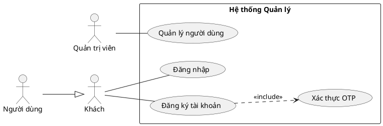
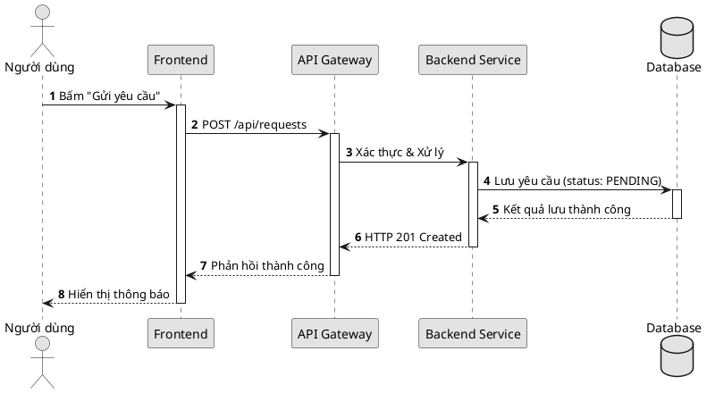
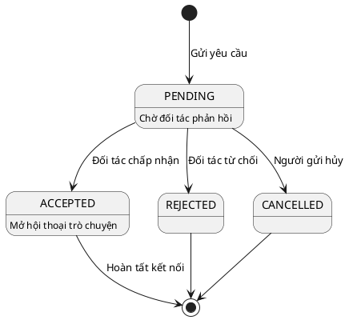
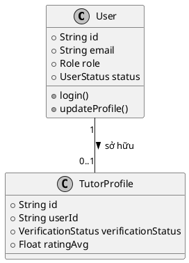

# PlantUML Diagrams Skill — Chuẩn mực UML Tuyệt đối cho Báo cáo & Luận văn

Mục tiêu: Tạo sơ đồ kỹ thuật **đúng 100% chuẩn quy ước UML 2.x / ISO**, **luôn luôn màu Trắng - Đen (B&W)**, khắc phục triệt để các nhược điểm của Mermaid (vẽ xấu, gãy góc, sai ký hiệu Use Case/UML).

## Vì sao PlantUML thay thế hoàn toàn Mermaid?

| Tiêu chí | Mermaid | PlantUML (`plantuml-diagrams`) |
| :--- | :--- | :--- |
| **Sơ đồ Use Case** | Dùng flowchart giả lập, node tròn, mũi tên sai chuẩn | **Hình người (`actor`), elip chuẩn, ranh giới hệ thống, `<<include>>`, generalization chính xác** |
| **Sơ đồ Tuần tự (Sequence)** | Căn chỉnh thô, khó phân nhóm alt/opt phức tạp | **Rõ ràng, thanh kích hoạt (`activate`), lifeline, note, loop, alt/opt chuẩn UML** |
| **Sơ đồ Lớp & ERD** | Khối chữ nhật thô, hiển thị quan hệ hạn chế | **Hiển thị đầy đủ field, method, visibility (`+`, `-`, `#`), quan hệ composition, aggregation** |
| **Thẩm mỹ in ấn** | Hay bị lỗi font tiếng Việt, màu mè không hợp học thuật | **Trắng - đen tối giản (`skinparam monochrome true`), tương phản cao, nét in ấn hoàn hảo** |

---

## 1. QUY TẮC THẨM MỸ: CHUẨN GIÁO TRÌNH HỌC THUẬT & LUCIDCHART MONOCHROME

Mọi sơ đồ PlantUML sinh ra cho báo cáo/đồ án bắt buộc tuân thủ bộ quy chuẩn thị giác (Visual Standards) chuẩn mực như Lucidchart, Visual Paradigm và giáo trình ĐH:

```plantuml
skinparam monochrome true
skinparam shadowing false
skinparam defaultFontName "Segoe UI", Arial, sans-serif
skinparam defaultFontSize 12
skinparam classFontSize 13
skinparam classAttributeFontSize 11
skinparam classAttributeIconSize 0    ' BẮT BUỘC: Dùng ký tự text +, -, # thay vì icon tròn màu
skinparam roundCorner 0               ' Hộp vuông vức sắc nét chuẩn mực giáo trình
skinparam dpi 300
skinparam linetype ortho              ' Đường nối vuông góc 90 độ tuyệt đối, không xiên vẹo
skinparam nodesep 70                  ' Giãn cách ngang rộng rãi, chữ không đè lên nhau
skinparam ranksep 70                  ' Giãn cách dọc thoáng đãng
```

### Các nguyên tắc vàng (Golden Rules):
1. **TUYỆT ĐỐI CẤM DÙNG `title` TRONG FILE PUML:** Tiêu đề sơ đồ luôn nằm ở dòng Caption tài liệu (`Hình 3.1: ...`). Nhúng `title` vào ảnh làm thừa diện tích và lặp chữ.
2. **`classAttributeIconSize 0`:** Hiển thị rõ ràng các ký hiệu phạm vi truy cập `+` (public), `-` (private), `#` (protected) theo chuẩn ISO/UML 2.x, không dùng icon hình tròn.
3. **Đường nối vuông góc 90° (`linetype ortho`):** Mọi dây nối gập góc vuông dứt khoát, không đi chéo ngang mặt class khác.
4. **Khoảng cách thở (Breathing Room):** `nodesep 70` và `ranksep 70` đảm bảo nhãn số lượng (`1`, `0..*`) và tên quan hệ luôn tách bạch, không bao giờ dính chữ.
5. **Cấm tiệt `skinparam handwritten true`:** Nét sketch méo mó và sinh banner cảnh báo làm mất tính trang nghiêm của báo cáo kỹ thuật.
6. **Chống nhồi nhét tương tác vào sơ đồ tầng (Inter-tier Anti-Crowding):** Trong sơ đồ kiến trúc phân tầng/khối, cấm chèn dày đặc nhãn thao tác CRUD, tìm kiếm, import/export lên đường nối. Chỉ vẽ khối và mũi tên phụ thuộc; chi tiết tương tác bắt buộc chuyển sang Sequence Diagram.

---

## 2. Các loại sơ đồ hỗ trợ & Cú pháp mẫu

### 2.1. Use Case Diagram (Chuẩn mực)


### 2.2. Sequence Diagram (Sơ đồ tuần tự)


### 2.3. State Diagram (Vòng đời trạng thái)


### 2.4. Class Diagram & ERD


---

## 3. Cách Render ra SVG & PNG

Sử dụng script tích hợp của skill:
```bash
# Render 1 file .puml ra cả .svg và .png (tự động)
node .claude/skills/plantuml-diagrams/scripts/render-puml.mjs --in diagram.puml
```

Output:
- `diagram.svg`: Dùng chèn vào Word (`docx-report`), PDF vector nét căng.
- `diagram.png`: Dùng dán vào Slide (`pptx-deck`), ảnh nét 2x.

---

## 4. Quy tắc QA cho Agent

1. **Kiểm tra cú pháp PlantUML:** Đảm bảo cặp `@startuml` và `@enduml`, không dùng từ khóa lạ phá vỡ ngữ pháp.
2. **Kiểm tra tác nhân:** 
   - Tác nhân chính (Primary Actors) luôn đặt bên trái (`left to right direction`).
   - Tác nhân phụ (Secondary / External Services) luôn đặt bên phải và gắn stereotype `<< Secondary >>`.
3. **Kiểm tra đường liên kết:**
   - Liên kết giữa Actor và Use Case luôn dùng nét thẳng `--`, **không dùng mũi tên** (Association chuẩn).
   - Kế thừa tác nhân dùng mũi tên tam giác rỗng `--|>`.
   - Quan hệ `<<include>>` và `<<extend>>` dùng nét đứt `..>`.
4. **Nhúng tài liệu:** Luôn cập nhật caption dưới hình: `Hình X.Y: <Tên sơ đồ>`.
5. **Bàn giao trực quan sạch (Zero Code Dumps):** Sau khi tạo mã và render thành công, trong phản hồi cho người dùng **CHỈ hiển thị ảnh trực quan** (``), tiêu đề `Hình X.Y: <Tên sơ đồ>`, và link dẫn đến file `.puml`. **TUYỆT ĐỐI CẤM** in/xổ toàn bộ code block `@startuml ... @enduml` ra khung chat làm rối giao diện.

