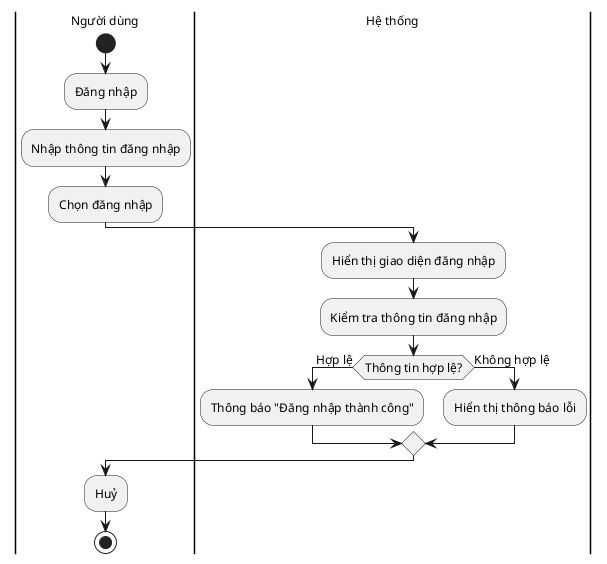

# Activity Diagram — Chuẩn VẼ TAY BẮT BUỘC & Swimlane (theo ảnh mẫu)

> **Trạng thái pháp lý:** theo SSOT [`diagram-orchestrator/reference/tool-sweet-spot.md`](../../diagram-orchestrator/reference/tool-sweet-spot.md) §0.1 (quyết định dự án 2026-10-26),
> **Activity Diagram BẮT BUỘC VẼ TAY** (`.drawio` mở bằng diagrams.net, hoặc SVG tay).
> PlantUML **CHỈ dùng làm bản nháp tham chiếu mô hình**, không phải bản nộp.
> Chuẩn thị giác: ảnh mẫu swimlane — 1 bảng có **dòng tiêu đề luồng** (vd "Đăng nhập") chạy ngang
> mép trên, **2 lane dọc "Người dùng | Hệ thống"**, activity = khối chữ nhật, decision = hình thoi,
> start = chấm đen, end = vòng tròn đôi. **Zero-color tuyệt đối** — mọi màu trong ảnh mẫu
> (kể cả vòng đỏ start/end) chỉ là tham chiếu cấu trúc, bản nộp luôn trắng-đen.
> Báo cáo/đồ án = **trắng-đen (zero-color)**, không `title` nhúng, caption `Hình X.Y` ngoài ảnh.

---

## 1. Luật cứng: CẤM MỘT ĐƯỜNG THẲNG DÀI VẮT QUA HÌNH

> [!CAUTION]
> **Không bao giờ để xuất hiện MỘT connector đơn lẻ dài gần hết hình** (nhất là đường thẳng
> đứng/ngang chạy dọc nhiều lane/tầng để quay về điểm merge). Đây là **lỗi BỐ CỤC**, không phải lỗi nét vẽ.
> Khi thấy một đường dài như vậy → **SẮP LẠI LAYOUT**, không kéo dây:
> 1. **Đưa điểm merge/nhánh lại GẦN decision** (kết thúc nhánh ngay cạnh điểm rẽ), không trả dây về tận trên/đáy.
> 2. **Đổi thứ tự khối** để hai đầu connector nằm gần nhau (dời node, không nối dài).
> 3. Nếu logic buộc phải xa → **phân rã thành 2 activity** (gọi sub-activity), không bắc cầu dài.
> Đây là cùng luật với `use-case-layout` §3.5 (NO FAR LOOPS) và `layout-thinking.md` §3 (ngân sách cạnh).

## 2. Mẫu swimlane (PlantUML) — CHỈ NHÁP THAM CHIẾU

> ⚠️ Mã PlantUML dưới đây chỉ dùng để **đối chiếu mô hình** (bước, nhánh, lane). **Bản nộp là
> bản vẽ tay draw.io/SVG** theo §2.1. Đừng render PlantUML rồi lấy ảnh làm kết quả.

## 2.1. Thông số draw.io (bản nộp chính thức — theo ảnh mẫu)

- **Khung swimlane = bảng:** dùng `swimlane` pool với `swimlaneTitle` (dòng tiêu đề ngang trên cùng,
  vd "Đăng nhập") + 2 cột lane; hoặc dựng tay bằng các `rectangle` mỏng làm header + các đường
  phân lane (nét liền đen 1pt). Lane trái = "Người dùng", lane phải = "Hệ thống".
- **Activity:** `rectangle` (hoặc bo góc nhẹ `rounded=1;arcSize=10`), `fillColor=#FFFFFF;strokeColor=#000000;fontColor=#000000;`,
  kích thước đồng nhất (vd 150×50), cỡ chữ 12–13, tên = động từ + đối tượng.
- **Start:** `ellipse` 20×20 `fillColor=#000000;strokeColor=#000000;` đặt trong lane "Người dùng" phía trên.
- **End:** vòng ngoài `ellipse` 30×30 viền đen không tô + chấm trong 18×18 đen đặc, căn tâm.
- **Decision:** `rhombus` (hình thoi) viền đen, nền trắng; lối ra nào cũng có guard.
- **Connector:** `edgeStyle=orthogonalEdgeStyle;rounded=0;strokeColor=#000000;` mũi tên kín;
  guard/điều kiện là label của cạnh, **nền nhãn trắng**. Nhánh quay về dùng elbow gọn, không vòng mép.
- Font `Segoe UI, Arial`, chữ ≥ 9pt khi in A4. Không `title` trong ảnh; caption `Hình X.Y` do `docx-report` sinh.

## 3. Quy tắc bố cục (đẹp, rõ, dễ nhìn)

1. **Mỗi tác nhân/hệ thống = một swimlane** (`|Tên|`). Mặc định: **người dùng bên trái, hệ thống bên phải**; không trộn lung tung.
2. **Một spine chính trên→xuống.** `start` trên cùng, `stop`/`end` dưới cùng. Luồng chính không đi zig-zag.
3. **Mọi nhánh `if/else` (decision) phải có guard `(điều kiện)`**; nhánh rẽ ngang rồi **quay về GẦN điểm rẽ** (không kéo dài về đáy rồi bắc cầu lên).
4. **`fork`/`join`** cho luồng song song; **`repeat`/merge diamond** cho vòng lặp.
5. **Swimlane tách luồng chính / ngoại lệ**: nhánh lỗi không chen vào spine chính.
6. **Nhãn bước = động từ + đối tượng, ngắn ≤ 25 ký tự**, tiếng Việt đủ dấu (font `"Segoe UI", Arial`).
7. **Điểm cắt nhau** vẽ nhảy (jump/bridge); hạn chế giao cắt tối đa.
8. **Zero-Title:** không nhúng `title`; caption `Hình X.Y: ...` do `docx-report` sinh.

## 4. Checklist soi ảnh (PASS mới được nộp)

- [ ] **Bản nộp là file nguồn `.drawio`/`.svg` + bản render `.svg`/`.png` tại `docs/diagrams/`** (ảnh PlantUML chỉ là nháp, không nộp).
- [ ] Khung swimlane có dòng tiêu đề luồng + 2 lane dọc "Người dùng | Hệ thống"; mỗi bước nằm đúng lane chủ thể.
- [ ] Start = chấm đen, end = vòng tròn đôi; các nhánh hội tụ đúng điểm kết thúc.
- [ ] **Không có một đường thẳng dài vắt gần hết hình** (kiểm bằng mắt trên ảnh PNG).
- [ ] Mỗi tác nhân đúng swimlane; người dùng trái, hệ thống phải.
- [ ] Spine chính trên→xuống, không zig-zag; mọi decision = hình thoi có guard trên cạnh.
- [ ] Nhánh quay về gần điểm rẽ; đường nối orthogonal, không chéo xuyên khối.
- [ ] Nhãn ngắn, đủ dấu, không đè lên đường/khối.
- [ ] Zero-color, không `title`, chữ ≥ 9pt ở A4; tỷ lệ khung 0.5–2.4.
- [ ] **Đã mở PNG soi mắt** (đè? đều? dễ nhìn?) và ghi Proof-of-View (≥ 3 nhãn nguyên văn + vị trí) — thiếu = `BLOCKED — Visual QA unavailable`; script chỉ tham khảo.
