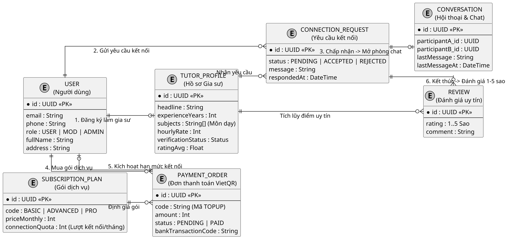

# Simplified Diagrams Skill — Sơ đồ Tinh gọn cho Báo cáo & Bảo vệ Đồ án

Mục tiêu: Giải quyết nghịch lý kinh điển trong đồ án & dự án thực tế:
- **Hệ thống thật:** 26 - 40 bảng cơ sở dữ liệu, 20 - 30 class backend.
- **Vấn đề khi báo cáo:** Đưa toàn bộ lên 1 sơ đồ sẽ biến thành "ma trận chằng chịt", chữ li ti không đọc được, in ra A4 bị vỡ nét, chiếu slide Hội đồng không nhìn thấy gì, và người thuyết minh **không biết bắt đầu phát biểu từ đâu**!
- **Giải pháp của skill:** Trích xuất **Mô hình Khái niệm (Conceptual Model)** theo Domain-Driven Design (DDD): **Giữ 100% chức năng cốt lõi**, lược bỏ toàn bộ bảng kỹ thuật/bảng phụ, giữ lại 5 - 8 thực thể trung tâm, kèm **Kịch bản thuyết minh phát biểu (Speaking Pitch)** giúp sinh viên/kỹ sư tự tin bảo vệ trước Hội đồng.

---

## 1. NGUYÊN TẮC TINH GỌN (ABSTRACTION RULES)

### Quy tắc 1: Luật Miller (7 ± 2 Nodes)
Một sơ đồ để trình chiếu hoặc phát biểu chỉ được chứa từ **5 đến 9 thực thể/khối trung tâm**. Quá 9 khối, não người nghe sẽ quá tải và mất khả năng theo dõi luồng logic.

### Quy tắc 2: Phân loại 3 tầng dữ liệu (3-Tier Filtering)
Khi nhận một schema 20-50 bảng hoặc hàng chục class:
1. **TẦNG CỐT LÕI (CORE DOMAIN — GIỮ 100%):**
   - Chỉ giữ các thực thể trực tiếp tạo ra giá trị nghiệp vụ chính của hệ thống.
   - Ví dụ nền tảng gia sư: `User`, `TutorProfile`, `ConnectionRequest`, `Conversation`, `SubscriptionPlan`, `PaymentOrder`, `Review`.
2. **TẦNG CHI TIẾT (VALUE OBJECTS / AGGREGATES — GỘP VÀO THỰC THỂ CHA):**
   - Không vẽ bảng riêng cho: `Message` (gộp vào `Conversation`), `Document` (gộp vào `TutorProfile`), danh mục `Subject`/`Grade`/`Area` (gộp thành mảng thuộc tính `subjects[]`, `grades[]` trong `TutorProfile`).
3. **TẦNG HẠ TẦNG & KỸ THUẬT (INFRASTRUCTURE — ẨN HOÀN TOÀN):**
   - Tuyệt đối không đưa vào sơ đồ thuyết minh các bảng:
     - Log / Audit: `AuditLog`, `SePayWebhookLog`, `SystemLog`.
     - Kỹ thuật / Auth: `PendingRegistration`, `OtpSession`, `RefreshToken`.
     - Cấu hình / CMS: `PageConfig`, `SystemSetting`, `IncidentAlert`.
     - Bảng join trung gian: `TutorSubject`, `TutorGrade`, `TutorArea`.

### Quy tắc 3: Mỗi mũi tên là một câu chuyện 10 giây
Mỗi đường nối trên sơ đồ phải trả lời được câu hỏi: *"Người thuyết trình sẽ nói gì về mũi tên này khi chỉ tay lên slide?"*
Nếu một đường nối chỉ mang tính kỹ thuật foreign key mà không có hành động nghiệp vụ → lược bỏ hoặc gộp lại.

### Quy tắc 4: Phân rã Sơ đồ Tuần tự (Sequence Decomposition — 4 đến 5 sơ đồ độc lập)
Tuyệt đối **KHÔNG** nhồi nhét toàn bộ hệ thống vào 1 Sơ đồ Tuần tự nguyên khối (Sequence Monolith Anti-Pattern) vì sẽ có tới 15-20 lifeline, 50 tin nhắn chạy dọc, không ai có thể theo dõi được!
Thay vào đó, **luôn phân rã thành 4 – 5 sơ đồ tuần tự tương ứng với 4 – 5 Use Case trọng điểm**:
1. **SEQ-01:** Đăng ký & Xác thực OTP qua Email (Auth & OTP).
2. **SEQ-02:** Gửi yêu cầu kết nối & Kiểm tra hạn mức gói (Connection & Quota Check).
3. **SEQ-03:** Gia sư chấp nhận kết nối & Mở phòng Chat Realtime (Accept & Chat).
4. **SEQ-04:** Quét VietQR & Webhook SePay kích hoạt gói tự động (Payment & HMAC Webhook).
5. **SEQ-05:** Nộp minh chứng & Kiểm duyệt hồ sơ gia sư (Tutor Verification).

**Tiêu chuẩn cho mỗi Sơ đồ Tuần tự tinh gọn:**
- Chỉ gồm 4 – 6 lifelines (Actor, Web UI, Core Service, PostgreSQL, 1 External Service nếu có).
- Từ 8 – 14 bước tương tác có `autonumber`.
- Có khối `alt / else` thể hiện rõ nhánh thành công và nhánh xử lý lỗi nghiệp vụ.
- Vừa vặn trọn vẹn 1 khung hình Slide 16:9 hoặc nửa trang A4 trong báo cáo Word.

---

## 2. QUY CHUẨN THẨM MỸ: CHUẨN SÁCH GIÁO TRÌNH & LUCIDCHART MONOCHROME

Mọi sơ đồ tinh gọn bắt buộc tuân theo bộ quy chuẩn thị giác cao cấp (học tập từ Visual Paradigm, Lucidchart và giáo trình CNTT):

```plantuml
@startuml
skinparam monochrome true             ' Trắng - đen học thuật tuyệt đối
skinparam shadowing false             ' Không đổ bóng bẩn
skinparam defaultFontName "Segoe UI", Arial, sans-serif
skinparam defaultFontSize 12
skinparam classFontSize 13
skinparam classAttributeFontSize 11
skinparam classAttributeIconSize 0    ' Hiển thị +, -, # text, không dùng icon tròn
skinparam roundCorner 0               ' Hộp chữ nhật vuông vức, sắc sảo
skinparam dpi 300
skinparam linetype ortho              ' Đường nối vuông góc 90 độ tuyệt đối
skinparam nodesep 70                  ' Giãn cách ngang rộng rãi (thoáng nét chữ)
skinparam ranksep 70                  ' Giãn cách dọc thoáng đãng
```

### Các nguyên tắc bất biến:
1. **CẤM NHÚNG TIÊU ĐỀ (`title` = BANNED):** Không dùng `title ...`. Tiêu đề sơ đồ luôn nằm ở dòng caption trong tài liệu báo cáo Word/Slide.
2. **BỐ CỤC 3 CỘT (3-COLUMN GRID LAYOUT):**
   - **Cột 1 (Trái - Tài khoản & Hồ sơ):** `USER`, `TUTOR_PROFILE`.
   - **Cột 2 (Giữa - Luồng tương tác chính):** `CONNECTION_REQUEST`, `CONVERSATION`, `REVIEW`.
   - **Cột 3 (Phải - Doanh thu & Thanh toán):** `SUBSCRIPTION_PLAN`, `PAYMENT_ORDER`.
   - Dùng liên kết ẩn để khóa thẳng hàng 3 cột: `A -[hidden]down- B`.
3. **KHÔNG ĐÈ NHÃN:** Khoảng cách `nodesep 70` và `ranksep 70` đảm bảo nhãn số lượng và tên quan hệ luôn có khoảng trống riêng biệt.

---

## 3. CÁC TEMPLATE TINH GỌN MẪU

### 3.1. Sơ đồ Thực thể Tinh gọn (Conceptual ERD — 7 Thực thể cốt lõi)


---

## 4. BẮT BUỘC KÈM THEO: KỊCH BẢN PHÁT BIỂU BẢO VỆ (SPEAKING SCRIPT)

Khi xuất ra sơ đồ tinh gọn, skill **BẮT BUỘC** sinh kèm đoạn kịch bản nói để người dùng mang vào phòng bảo vệ:

```markdown
### Kịch bản phát biểu 60 giây trước Hội đồng:
"Kính thưa Thầy Cô trong Hội đồng,
Trên slide là **Sơ đồ thực thể khái niệm** của hệ thống, được tinh gọn thành 7 thực thể trung tâm đại diện cho toàn bộ giá trị cốt lõi:

1. **Phân hệ Hồ sơ:** Người dùng (`USER`) có thể đăng ký nâng cấp thành Gia sư (`TUTOR_PROFILE`) với hồ sơ năng lực và chứng chỉ xác minh.
2. **Phân hệ Kết nối & Tương tác:** Phụ huynh gửi yêu cầu kết nối (`CONNECTION_REQUEST`). Khi gia sư chấp nhận, hệ thống tự động sinh phòng trò chuyện (`CONVERSATION`) để hai bên thảo luận chi tiết mà không thu phí hoa hồng bài học.
3. **Phân hệ Gói dịch vụ & Doanh thu:** Nền tảng duy trì vận hành bằng mô hình bán lượt kết nối (`SUBSCRIPTION_PLAN`). Người dùng quét mã VietQR tự động qua SePay (`PAYMENT_ORDER`) để kích hoạt thêm lượt kết nối mỗi tháng.
4. **Phân hệ Xây dựng Niềm tin:** Sau khi kết nối, hai bên đánh giá lẫn nhau (`REVIEW`) 1-5 sao để duy trì minh bạch học đường.

Các bảng kỹ thuật như log kiểm toán, bảng tạm OTP và bảng danh mục được quản lý ngầm ở tầng cơ sở hạ tầng để đảm bảo hệ thống vận hành trơn tru."
```

---

## 5. CÔNG THỨC ROUTING CHO AGENT

- Khi người dùng hỏi: *"Vẽ sơ đồ đầy đủ chi tiết cho toàn bộ code"* → Dùng `plantuml-diagrams` (đầy đủ 26 bảng, 20 class).
- Khi người dùng nói: *"Sơ đồ đơn giản hơn", "lược bớt chi tiết", "để làm báo cáo bảo vệ", "đông bảng quá khó nhìn", "tối giản lại"* → **KÍCH HOẠT NGAY SKILL `simplified-diagrams`**:
  1. Trích xuất 5-8 thực thể cốt lõi.
  2. Bố cục 3 cột chuẩn mực, đường nối vuông góc `linetype ortho` hoặc `polyline` (tránh nét sketch méo lệch).
  3. Render ra `.svg` và `.png` 300 DPI qua `render-puml.mjs`.
  4. Chạy `diagram-auditor` kiểm định đạt PASS 100%.
  5. **Bàn giao trực quan sạch (Zero Code Dumps):** Trong phản hồi chat, **CHỈ hiển thị ảnh trực quan (``), tiêu đề `Hình X.X: <Tên sơ đồ>`, kịch bản phát biểu 60-90 giây, và link tệp nguồn**. TUYỆT ĐỐI KHÔNG in code block PlantUML ra chat làm rối màn hình.

