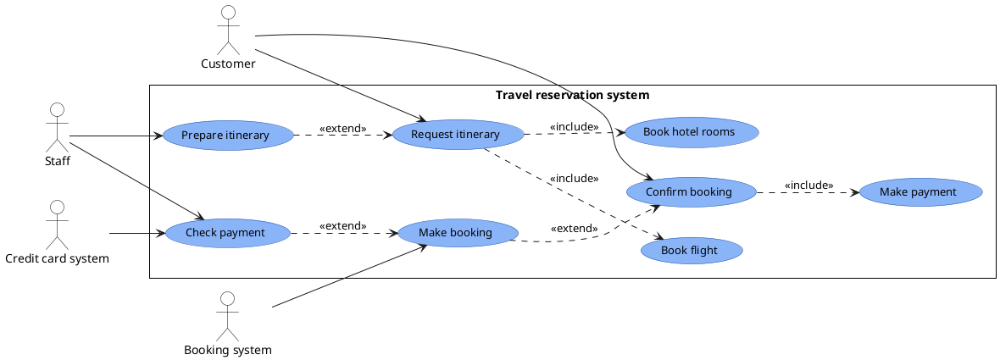

> **Quy tắc hiện hành (02/11/2026):** bản cuối dùng `handdrawn-diagrams`: Python toạ độ cố định → `docs/diagrams/vectors/*.svg` + `docs/images/diagrams/*.png`, spec JSON riêng. PlantUML/Graphviz/Mermaid/drawio/tldraw trong các ví dụ bên dưới chỉ dùng nháp. Nguồn `.py` là bắt buộc. Duyệt ngữ nghĩa theo nguồn, chạy `run_diagrams.py` (cổng máy), rồi Vision QA từng hình; không suy PASS bố cục từ exit 0. Use Case chung gốc ở junction thân–tay `(ax, ay−4)` = tâm đầu +18 với mẫu hiện hành, không ở bụng. State đọc `plantuml-diagrams/reference/state-playbook.md`, không note/legend/footer trên canvas. Khi hướng dẫn cũ trái khối này, áp dụng khối này.


# Skill: Thiết kế Use Case Diagram đúng nghiệp vụ, bố cục cân đối, đường nối sạch

> **Scope guard:** Skill này sở hữu bố cục Use Case, không phải Class Diagram/ERD. Với UML Class Diagram, dùng quy tắc SSOT tại [diagram-orchestrator/reference/class-diagram-layout.md](../diagram-orchestrator/reference/class-diagram-layout.md); không áp máy móc luật actor hai bên, ellipse hoặc ngưỡng Use Case sang loại sơ đồ khác.

> **Bố cục actor–chức năng:** đọc [reference/actor-function-composition.md](reference/actor-function-composition.md) trước Bước 2. Đây là SSOT cho bố cục theo ảnh mẫu: actor tỷ lệ bình thường, association thẳng tỏa chung gốc ở thân, chức năng lệch theo cụm.

## 1. Mục tiêu

Tạo sơ đồ Use Case UML vừa **đúng mô hình nghiệp vụ**, vừa **dễ đọc khi in A4 hoặc chèn vào Word**. Ưu tiên bố trí có chủ đích và kiểm chứng hình render, không chấp nhận sơ đồ tự động sinh ra rồi mặc định là đạt. Mọi sơ đồ cho báo cáo/đồ án/luận văn học thuật tuân thủ phong cách **trắng-đen (zero-color)**, KHÔNG dùng màu (xem `AGENTS.md` §Nguyên tắc bất biến #13 và SSOT tại `diagram-orchestrator`).

Skill này hướng dẫn Agent lập mô hình, chọn bố cục, **vẽ tay (draw.io/SVG)**, render và **duyệt lại bằng mắt**. **Không dùng công cụ tạo ảnh để thay cho sơ đồ UML có cấu trúc**: sơ đồ phải sửa được, quan hệ phải kiểm tra được và phải có mã nguồn/tệp gốc.

> [!CAUTION]
> **2 LUẬT CỨNG CỦA USE CASE (không thương lượng):**
> 1. **VẼ TAY là mặc định bắt buộc.** PlantUML/Mermaid/các bộ auto-layout **KHÔNG ghim được vị trí** actor và điểm neo đường nối, nên chúng tự dồn actor về một phía và kéo dây chằng chịt. Use Case **được vẽ bằng tay** (`.drawio` mở bằng diagrams.net, hoặc SVG tay) để chủ động đặt actor hai bên, canh cột/hàng và đi dây ngắn. Auto-layout chỉ là bản nháp tham chiếu, KHÔNG phải bản nộp.
> 2. **DUYỆT BỐ CỤC BẰNG MẮT SOI ẢNH, KHÔNG bằng script.** Sau khi vẽ, Agent **bắt buộc mở ảnh render** và tự trả lời: *đường nối có đè lên ellipse/chữ/tên actor/nhãn không? các nhóm chức năng có cách đều, cân, nhìn dễ không?* Script tự động (đếm toạ độ, phát hiện giao cắt…) **không phán đúng được cái "đều/đẹp/dễ nhìn"**, nên **không dùng script làm cổng quyết định bố cục**. Bằng chứng bắt buộc là mô tả cụ thể những gì **mắt đã thấy trên ảnh**.

> [!CAUTION]
> **CỔNG PASS HAI ĐIỀU KIỆN (khớp `diagram-auditor` §1.5) — thiếu một = FAIL:**
> - **ĐK1 MÁY:** script 0 lỗi + **file nguồn vẽ (`.py` generator / `.drawio`) TỒN TẠI** + **file ảnh `.png` + `.svg` TỒN TẠI >500B**.
> - **ĐK2 VISION:** **model có vision** soi ảnh thật, ghi ≥3 nhãn nguyên văn + vị trí + kết luận "sắp xếp đã hợp lý chưa" + `Vision audit by: <model-id>`. Model text-only **không tính**.
> - Ảnh có mà thiếu `.py`/`.drawio` nguồn = **FAIL** (không tái lập được); chỉ chạy script = **FAIL**; chỉ nhìn ảnh = **FAIL**.

> [!CAUTION]
> **3 LUẬT THẨM MỸ KHÔNG THƯƠNG LƯỢNG (áp cho MỌI sơ đồ Use Case):**
> 1. **GỌN** — ít giao cắt, khoảng cách đều, nhóm rõ ràng.
> 2. **ĐẸP** — căn chỉnh, nhãn ngắn, ellipse nhất quán.
> 3. **DỄ NHÌN** — đường nối **ngắn và trực tiếp**; **TUYỆT ĐỐI KHÔNG VẼ VÒNG XA** (xem §3.5).

> [!CAUTION]
> **2 LUẬT CHỐNG-GIAN-DỐI (chống tự lừa mình):**
> 1. **CẤM GEN HÀNG LOẠT.** Không được sinh N sơ đồ rồi tuyên bố "cả N đều đạt" trong một câu.
>    Mỗi hình là **một vòng nghiệm thu riêng** với `*-audit.md` riêng, `overlay.png` đã mở,
>    và **mọi** file trong `crops/` đã mở. Xem [reference/visual-audit-protocol.md](reference/visual-audit-protocol.md) §1.
> 2. **CẤM CHỈ CHẠY SCRIPT RỒI PASS — VÀ CŨNG CẤM CHỈ NHÌN ẢNH 100%.**
>    Phải làm **cả hai**: `eye_audit.py` thu hẹp phạm vi (và cắt ảnh zoom 4×), rồi **mắt phán quyết**
>    trên từng vùng hẹp. Bằng chứng thật đã cho thấy nhìn ảnh 100% **đã bỏ sót** lỗi đường nối
>    xuyên qua tên actor, và script thì **báo oan** nhãn chỉ *sát* vỉa — xem protocol §5.

## 2. Luật chặn cứng

> **Không xác định bài toán và tác nhân thì cấm vẽ.**

Trước khi tạo `.puml`, XML draw.io, SVG hoặc sơ đồ ở bất kỳ định dạng nào, bắt buộc tạo và hoàn thiện `docs/domain/step0-<du-an>.md` (path canonical theo `diagram-orchestrator`) theo mẫu [step0-bai-toan-va-tac-nhan.md](../diagram-orchestrator/reference/step0-bai-toan-va-tac-nhan.md) (bài toán, quy mô, tác nhân + trách nhiệm **kèm nguồn bằng chứng / UNKNOWN**).

Nếu chưa có file này hoặc thông tin cốt lõi chưa được xác minh:

1. Phát đúng thông báo: `⚠️ VI PHẠM KỶ LUẬT: chưa xác định bài toán/tác nhân (thiếu Bước 0).`
2. Dừng việc vẽ và tối ưu bố cục.
3. Hoàn thành Bước 0; ghi rõ nội dung chưa biết là `UNKNOWN` và yêu cầu xác nhận khi cần. Không tự bịa vai trò để lấp chỗ trống.

Reviewer phải trả `FAIL — lỗi tư duy mô hình hóa, không phải lỗi bố cục` với mọi sơ đồ không có Bước 0 đạt yêu cầu.

## 3. Luồng thực thi bắt buộc

### Bước 0 — Xác định bài toán, quy mô, tác nhân

Tạo file Markdown trước khi tạo bất kỳ sơ đồ nào. Phải làm rõ:

- Vấn đề hiện tại, đối tượng gặp vấn đề và mục tiêu hệ thống.
- Quy mô đã biết: nhóm người dùng/vận hành, tần suất, tải hoặc khối lượng. Nếu không có số liệu thì ghi `UNKNOWN`, không tự ước lượng như dữ kiện.
- Mỗi actor: mục tiêu, trách nhiệm, quyền hạn và điều actor **không** làm.
- Phân biệt người xử lý nghiệp vụ với người sửa lỗi kỹ thuật; người kiểm duyệt với quản trị viên; quản trị tài khoản với vận hành nghiệp vụ.
- Hệ thống nằm trong phạm vi và hệ thống/dịch vụ bên ngoài nằm ngoài phạm vi.
- Mức trừu tượng và chiến lược phân rã: sơ đồ tổng quan hay nhiều sơ đồ con. **20–25 use case trong một hình vẫn chấp nhận được**, miễn các node **không đè/chồng nhau** và mọi connector **lần theo được** (người dùng audit tay phần này). Chỉ khi quá **25 use case** mới mặc định đề xuất chia nhỏ; giữ một hình quá 25 cần lý do rõ ràng.
- Các giả định, điểm còn thiếu và **nguồn chứng cứ** cho từng quyết định quan trọng.

Không đưa nút bấm, trường nhập liệu, thao tác điều hướng hoặc chi tiết giao diện thành use case độc lập, trừ khi chúng thực sự là mục tiêu nghiệp vụ của actor.

### Bước 1 — Chốt mô hình UML

Từ Bước 0, lập danh sách có kiểm soát + **bảng traceability** (xem `reference/include-extend-inheritance.md` §5):

- Actor và mục tiêu actor. Use case và actor nào khởi tạo/tham gia.
- Ranh giới hệ thống. Quan hệ association, `<<include>>`, `<<extend>>` và generalization **chỉ khi trả lời được test 1 câu** (xem `reference/include-extend-inheritance.md` §1).
- Các luồng nghiệp vụ chính, ngoại lệ và quyền hạn ảnh hưởng đến sơ đồ.
- **Bảng traceability:** mỗi dòng = mỗi quan hệ, test 1 câu bắt buộc, mục đích rõ ràng. Không trả lời được test → xóa dòng. Lưu file `docs/diagrams/<name>-model.md`.

Quy tắc quan hệ:

- Association là đường liền giữa actor và use case; **không vẽ mũi tên** nếu không có quy ước cụ thể cần thể hiện.
- `<<include>>` dùng khi use case cơ sở **luôn** gọi hành vi dùng chung bắt buộc; mũi tên nét đứt hướng **về use case được include**.
- `<<extend>>` dùng cho hành vi mở rộng **có điều kiện**; mũi tên nét đứt hướng **về use case cơ sở được mở rộng**.
- Generalization dùng khi thật sự có quan hệ kế thừa actor/use case; tam giác rỗng hướng về phần tử tổng quát. Chỉ dùng khi **is-a** thật sự và con kế thừa **toàn bộ** quyền cha (xem `reference/include-extend-inheritance.md` §3).
- **Không thêm quan hệ để sơ đồ "trông giống UML mẫu".** Nếu quan hệ khó giải thích bằng một câu nghiệp vụ rõ ràng → bỏ hoặc xác minh lại.
- **Test 1 câu bắt buộc:** mỗi `include`/`extend`/generalization phải trả lời được test trong `reference/include-extend-inheritance.md` §1; không trả lời được → bỏ quan hệ.
- Use case đặt tên theo mục tiêu/hành động nghiệp vụ, ngắn, nhất quán, không mô tả thao tác UI.

Lưu file mô hình hoặc bảng traceability trước khi bố trí hình. **Không thay đổi ý nghĩa nghiệp vụ chỉ để làm đường nối đẹp hơn.**

### Bước 2 — Chọn bố cục trước khi vẽ đường nối

#### 2.1 Phân vùng — KHÓA ACTOR TRÁI/PHẢI (luật cứng)

- Vẽ **system boundary trước**; tên hệ thống đặt ở mép trên bên trong khung.
- **KHÓA VỊ TRÍ ACTOR:** mọi actor **CHỈ** được đứng ở **cột trái (Lane L)** hoặc **cột phải (Lane R)**
  của sơ đồ — **CẤM** đặt actor ở giữa, trên đỉnh, dưới đáy, hoặc rải lung tung 4 phía lẫn với use case.
  - Lane L: vai trò có cụm chức năng thuận bố trí bên trái.
  - Lane R: vai trò có cụm chức năng thuận bố trí bên phải, kể cả người khởi tạo, nhân viên hoặc lãnh đạo; không dành riêng cho hệ thống ngoài.
  - Ngoại lệ duy nhất: sơ đồ chỉ có 1 actor → được đặt trái (mặc định). Mọi ngoại lệ khác phải ghi lý do
    vào file model và vẫn KHÔNG được nhét actor vào giữa cụm use case.
- **Anti-pattern (thấy là FAIL Visual):** actor cắm giữa hai use case; actor trên nóc boundary;
  actor mỗi nơi một cái không theo cột; actor đè lên system boundary/package/use case.
- Nếu nhiều actor, chia theo nhóm vai trò ở hai bên; không xếp mọi actor thành một cụm trên một cạnh.
- Tên actor đặt gần actor (thường phía dưới), không bị đường nối xuyên qua.
- Use case xếp theo **cụm luồng nghiệp vụ** (§3.2b): trong cụm căn tâm, ellipse nhất quán, nhịp hàng đều; **giữa các cụm** chừa khoảng trống lớn hơn để mắt tách nhóm. Cấm xếp mọi use case thành một cột duy nhất với một bước đều từ đầu đến cuối hình — đó là lưới máy móc.
- Tránh đặt use case "nhiều kết nối" ở vị trí khiến mọi đường phải xuyên qua use case khác.

#### 2.2 Lập bảng layout TRƯỚC khi nối dây

Tạo bảng với ít nhất: `element_id`, `label`, **`kind` (`actor`/`usecase` — BẮT BUỘC)**, `group`, `side/lane`, `row`, `connected_actors`, `relationship_edges`. **Chọn vị trí actor và use case trước, rồi mới vẽ cạnh.**
Với actor, cột `side/lane` **bắt buộc chỉ nhận `L` hoặc `R`** — actor nào không xếp được vào L/R
là dấu hiệu mô hình sai (thừa actor hoặc chưa phân vai), phải quay lại Bước 0/1, không được "nhét tạm vào giữa".

> [!CAUTION]
> **GATE TRƯỚC KHI VẼ (tự kiểm bằng mắt trên bảng, không giao cho script):** lưu bảng layout thành file Markdown
> (vd. `docs/diagrams/<name>-layout.md`) rồi tự đọc lại và xác nhận **đủ 3 điều kiện**, chỉ được vẽ tiếp khi đạt cả ba:
> 1. Mọi dòng `kind = actor` có `side/lane` **chỉ là `L` hoặc `R`** (không có actor ở "giữa/đỉnh/đáy").
> 2. Không có `element_id` trùng; mọi actor đều có mặt trong ít nhất một `connected_actors`.
> 3. Mỗi cặp `include/extend` đã có `base` và `target` **cùng vùng/row gần nhau** (để đi dây ngắn).
>
> Chưa đạt → **DỪNG**, sửa bảng (quay lại Bước 0/1 nếu thấy thừa/thiếu actor), rồi mới vẽ. Bảng layout là để **đặt node**, không phải để "chấm điểm hình".
>
> **Script tự động KHÔNG được dùng làm cổng quyết định.** Script chỉ đếm toạ độ nên không biết line có *đè* mắt thấy, khoảng cách có *đều* mắt thấy, hay nhóm chức năng có *dễ nhìn* không. Cổng quyết định bố cục là **mắt soi ảnh render** (xem [Bước 4 — Visual Review](#bước-4--render-kiểm-tra-a4-và-nghiệm-thu)).

Dùng các lane khái niệm:

- **Lane L:** actor/nhóm actor bên trái.
- **Lane C-L / C-R:** nhóm use case bên trong hệ thống.
- **Lane R:** actor của cụm bên phải, không phân biệt chính/phụ hay người/hệ thống.
- **Lane R-REL:** vùng dành cho quan hệ nét đứt (`include/extend`) nếu thật cần.

> [!IMPORTANT]
> **Đặt cặp use case có quan hệ `include/extend` Ở GẦN NHAU (ngang hàng hoặc liền kề) ngay từ bước lập bảng layout** — đây là cách phòng ngừa vòng xa hiệu quả nhất. Nếu base và target phải nối mà ở xa nhau → **đổi `row`/`lane` cho chúng gần lại** trước khi vẽ.

### Bước 3 — Đi dây để giảm giao cắt

#### 3.1 Thứ tự nối

1. Nối **association** chính của từng actor tới use case **gần nhất**.
2. Nối association ít cạnh tranh hơn.
3. Nối `include`, `extend`, generalization **sau cùng**.
4. Đặt **nhãn quan hệ sau khi hình học đã ổn định**.

#### 3.2 Quy tắc hình học

- **LUẬT 1 ĐIỂM XUẤT PHÁT + ĐƯỜNG THẲNG (bắt buộc, sửa 2026-11-01):** mọi association của một actor xuất phát từ **ĐÚNG MỘT ĐIỂM ở khuỷu tay** (junction thân–tay `(ax, ay−4)`), và mỗi cạnh là **đoạn thẳng** `<line>` tới mép ellipse — **KHÔNG dùng cung Bézier cho dây nối**. Lý do: *"vòng cung" là hình ELLIPSE (chức năng), không phải dây nối*; và tia đi lên từ bụng **cắt ngang cánh tay** (đo được 1 cạnh vi phạm). Cùng luật cho `include`/`extend` (nét đứt + mũi tên hở theo dây cung).

> Luật cũ "1 bụng + vòng cung" (association = quadratic Bezier, `CURVE = 0.18`) **đã bị thay thế**. `CURVE > 0` chỉ bật khi người dùng yêu cầu rõ.
- Ưu tiên đường **ngắn, trực tiếp, dễ lần theo**. `include`/`extend` giữa các node kề nhau → **cung nhẹ**, miễn không xuyên qua phần tử nào (mọi phép kiểm của `eye_audit.py` vẫn áp dụng cho **mẫu polyline của cung**).
- **CẤM một connector đơn lẻ dài vắt gần hết hình** (một đường thẳng dài chạy ngang/dọc qua nhiều cụm use case). Thấy đường dài → **sắp lại layout**: đưa hai đầu lại gần nhau (đổi `row`/`lane`), hoặc gộp nhóm — KHÔNG kéo dây dài cho vừa.
- Hạn chế giao cắt; **cấm đường nối xuyên qua ellipse/use case, tên actor hoặc nhãn quan hệ**.
- **Tên actor không được bị dây xuyên qua.** Neo chung ở junction thân–tay, đặt tên phía ngoài chùm tia và kiểm tia dốc nhất; không gom dây thành bus. Theo SSOT actor-function-composition.
- Không chạy đường nối qua nội dung trong package để tới phần tử phía bên kia.
- Không để connector trùng khít tới mức không phân biệt được cạnh nào tới use case nào.
- Với đường chéo sẽ đâm xuyên thành phần: dùng connector **orthogonal/elbow**. Chỉ bẻ góc khi nó **thực sự làm đường rõ hơn**; không bẻ quá nhiều thành mê cung.
- Khi nhiều cạnh giao nhau, **ĐỔI VỊ TRÍ NODE TRƯỚC**, không lập tức thêm hàng loạt điểm gấp.
- Actor liên kết nhiều use case → đặt actor ngang **vùng trung tâm** của cụm use case liên quan; sắp use case theo thứ tự luồng/nhóm để các cạnh tỏa gọn.
- Nhiều actor liên kết cùng một use case → đặt use case gần ranh giới giữa nhóm liên quan (vẫn trong đúng package).
- Nhãn use case **ngắn, lý tưởng 1 dòng, ≤ 25 ký tự**; nếu bắt buộc dài hơn → đổi cách diễn đạt hoặc phân rã, **không bóp méo ellipse để nhét chữ**.
- `nodesep`/`ranksep` chỉ là **tham số khởi đầu**, KHÔNG phải bằng chứng hình đã đẹp. Điều chỉnh theo **bản render** và kích thước in thực tế.

#### 3.2b Bố cục TỰ NHIÊN — chống "lưới máy móc"

> Đường sạch + một bước đều tuyệt đối từ đầu đến cuối hình = sơ đồ giống **sơ đồ đi dây**: không đè, không vòng xa, nhưng đọc mệt và trông máy móc. Mục tiêu là bố cục **có chủ đích như người thiết kế xếp**, không phải lưới toán học.

Sáu nguyên tắc (áp lúc lập bảng layout Bước 2.2, không đợi đến khi đi dây):

1. **Xếp theo LUỒNG, không xếp theo lưới:** thứ tự dọc trong cụm = thứ tự nghiệp vụ (bước chính trước, bước phụ/ngoại lệ sau); cặp `include`/`extend` đặt cạnh nhau (§3.5); actor đứng ngang tầm **trọng tâm cụm** nó liên kết.
2. **Khoảng cách có ngữ nghĩa:** nhịp **trong cụm nhỏ**, **giữa các cụm rộng hơn rõ rệt** (≈ ≥ 2× nhịp trong cụm). "Đều" = nhịp ổn **trong từng nhóm** — KHÔNG phải một bước đều toàn hình.
3. **Chống thang máy (ladder):** một cột ≥ ~7 use case → tách thành 2–3 cột theo nhóm chức năng; được phép **lệch hàng có chủ đích** giữa các cụm (stagger) miễn mọi đường nối vẫn sạch theo §3.2.
4. **Neo chung đúng mẫu:** association tỏa từ **đúng một điểm** ở khuỷu tay actor tới mép từng ellipse; **không rải neo** (rải neo là lỗi, không phải cách né C-FAN).
5. **Đường nối THẲNG là mặc định:** mỗi dây là đoạn thẳng từ khuỷu tay tới ellipse; chỉ dùng cung khi người dùng yêu cầu rõ.
6. **Cân ảnh:** khối nội dung bám quanh trục giữa (U-OCCUPY); hai bên boundary không bên nào trắng hoác — cụm nhiều kết nối hơi lệch tâm là chấp nhận được nếu tổng thể cân.

Kiểm chống-máy-móc bằng mắt (thêm vào Visual Review): thu nhỏ ảnh còn ~25% — nếu thấy **một dải node trải đều như thang máy** thay vì **các cụm có khe sáng tách nhóm** → bố cục máy móc, xếp lại theo nguyên tắc 1–3.

> **Bố cục theo ảnh mẫu:** áp dụng [actor-function-composition.md](reference/actor-function-composition.md). Quạt chung gốc hợp lệ; không kéo actor cao theo cột UC, không bắt buộc cột bậc thang hay cung tròn bán kính cố định.

#### 3.3 Quy tắc khi dùng PlantUML

- Bố trí logic theo nhóm và lane; alias ổn định; dùng `left/right` hoặc liên kết ẩn **chỉ khi thực sự** giúp ổn định thứ tự.
- **Không tạo liên kết nghiệp vụ giả chỉ để điều khiển layout.**
- Không giả định PlantUML cho ra vị trí đúng nhờ `left to right direction`, `nodesep` hay `ranksep`.
- Nếu PlantUML **vẫn sinh connector chồng chéo/vòng xa sau vài lần chỉnh hợp lý** → **chuyển sang draw.io** để định vị thủ công (giữ nguyên mô hình UML đã duyệt). Đừng vá mã vô hạn.
- Ngưỡng cứng: **≥ 2 vòng render → soi → sửa-1-biến mà Visual vẫn FAIL → dừng vá mã, chuyển fallback**.
  Quy trình 6 bước (freeze ngữ nghĩa, dựng `.drawio` tay, đi dây ngắn-trực tiếp, giữ zero-color+UML, xuất SVG+PNG, qua auditor):
  xem SSOT [`diagram-orchestrator/reference/manual-fallback.md`](../diagram-orchestrator/reference/manual-fallback.md).

#### 3.4 Quy tắc khi vẽ tay / draw.io — ĐÂY LÀ ĐƯỜNG CHÍNH CỦA USE CASE

> **Với Use Case, vẽ tay là MẶC ĐỊNH, không phải fallback.** Không cần "thử auto cho đủ 2 vòng rồi mới được vẽ tay": auto-layout không ghim được vị trí nên cứ vào thẳng draw.io/SVG để chủ động bố cục. (Auto chỉ dùng làm bản nháp tham chiếu.)
> Quy trình đầy đủ: SSOT `diagram-orchestrator/reference/manual-fallback.md`.

> [!IMPORTANT]
> **SINH NHANH BẰNG SCRIPT + BÀN GIAO FILE WEB-EDITABLE (khuyến nghị khi người dùng muốn tự chỉnh):**
> lập JSON model (actors / usecases / associations / includes / extends — mẫu trong docstring script) rồi chạy
> `python scripts/make_drawio.py --spec <model>.json --out docs/diagrams/<ten>.drawio`.
> Script đặt node theo **cột-theo-cụm bậc thang** (§3.2b — TUYỆT ĐỐI không cung tròn quanh actor, không 1 cột dọc),
> node include/extend đặt lệch sang phải cạnh partner với dây ngắn; mỗi edge mang **`exitX/exitY/entryX/entryY`
> tường minh** để chùm dây hội tụ **đúng 1 điểm tại junction thân–tay actor** — junction thân–tay (`điểm neo theo junction thân–tay của hình actor`),
> kiểu "quat ga" góc chung kinh điển của UML (yêu cầu người dùng 2026-11-01; đặt `"fan": "spread"` trong spec
> nếu muốn rải neo dọc thân như bản cũ) mà vẫn **GLUED**
> (kéo hình thì dây đi theo); tên actor đặt **bên cạnh** hình (trái với Lane L, phải với Lane R) để chùm dây
> không bao giờ xuyên tên. Script sinh SVG preview **cùng toạ độ, cùng điểm neo, có mũi tên
> «include»/«extend»** để chạy `eye_audit.py` nghiệm thu trước khi bàn giao — truyền
> `--svg-out docs/images/diagrams/<ten>.svg` để SVG nằm ở **thư mục render riêng, 1 diagram = 1 bản SVG
> duy nhất** (mặc định ghi `<ten>-preview.svg` cạnh `.drawio`); script còn tự báo
> `[CANH BAO] day ... XUYEN ellipse` / `CAT day` nếu hình học sai.
> File `.drawio` có **edge GLUED** (source/target id): mở tại **app.diagrams.net** (web miễn phí, có đủ
> Straight/Elbow/Bendy line) hoặc **import thẳng vào Lucidchart** (Lucid hỗ trợ import `.drawio`/`.xml`) —
> người dùng kéo hình thì line đi theo, đổi kiểu line ngay trong editor. **Bàn giao cho người dùng LUÔN
> kèm file `.drawio`** để họ tự tinh chỉnh line (yêu cầu người dùng 2026-10-29).
>
> Ghi chú kỹ thuật: điểm neo actor (fan mặc định) = **`điểm neo theo junction thân–tay của hình actor`** — junction thân–tay
> `(w/2, 2h/3)` của shape `umlActor` (box 40×60 ⇒ +10px dưới tâm hình); mọi dây của một actor rời đúng
> **1 điểm** đó. Entry trên ellipse kẹp trong `0.12–0.88` để dây không chạm mép trên/dưới. Nếu tự vẽ tay,
> giữ đúng hai con số này. (Kiểu cũ `"fan": "spread"`: `exitY = 0.5 + (oy − ay)/60` với `oy = ay + 6 ± 16`
> → dây rời thân 0.33–0.87 chiều cao.)

> [!CAUTION]
> **HỢP ĐỒNG TỐI THIỂU KHI TỰ VIẾT GENERATOR (bài học audit btl-cnpm 2026-11-01 — 4 lỗi P1 đã xác minh):**
> 1. **Giữ trường `side` L/R của actor** đọc từ model — **cấm** hard-code mọi actor về trái hoặc về một `x` cố định. Bỏ qua `side` là lỗi P1 (đã thấy: 4 vai trò bị dồn hết bên trái).
> 2. **Neo association vào junction thân–tay actor** — với SVG, tính từ hình người thật (junction thân–tay), **không** dùng `(x,y)` là chân/ngoài thân; với draw.io dùng điểm neo tính từ junction thân–tay (không hard-code tỷ lệ từ mẫu cũ).
> 3. **Entry ellipse phải tính giao điểm theo hướng cạnh** (tham số hóa ellipse) và **đồng bộ SVG ↔ draw.io**: cùng công thức, cùng `entryPerimeter=0`. Cấm kiểu SVG dùng mép trái cố định `(cx−rx, cy)` cho mọi góc còn draw.io dùng `entryX=0; entryY=0.5`.
> 4. **Không sinh một cột dọc duy nhất** cho mọi use case (`y += hằng số` cho mọi hàng) — bố cục phải theo cụm, nhịp giữa cụm ≥ 2× nhịp trong cụm (§3.2b). Một cột dài + nửa phải trống là lỗi P1 (đã thấy ở cả 4 hình btl-cnpm).
> 5. **Generator chạy exit 0 không chứng minh hình đạt.** Sau khi sinh, bắt buộc render PNG/SVG rồi mở ảnh soi theo Bước 4 — không được báo PASS từ log generator.


Sau khi vẽ tay và render, **bắt buộc soi ảnh** và tự rà theo checklist "đè / đều / dễ nhìn" ở [Bước 4](#bước-4--render-kiểm-tra-a4-và-nghiệm-thu) — thay vì chạy script rồi tin script.

- Đặt system boundary, vùng chức năng, ellipse và actor **trước**; kiểm khoảng trống rồi mới nối dây.
- Dùng grid/snap và căn chỉnh; cùng hàng/cột thì căn tâm/mép nhất quán.
- Connector endpoint đặt **đúng** vào actor/use case; không để đường kết thúc lơ lửng hoặc chạm sai phần tử.
- **Di chuyển ellipse để giải quyết giao cắt**; không kéo actor ra ngoài ranh giới theo cách gây hiểu nhầm actor thuộc hệ thống.
- Bật/tắt điểm bẻ connector **có chủ đích**; không để các đường cùng loại quan hệ có hình thức khác nhau ngẫu nhiên.
- **Lưu tệp gốc chỉnh sửa được** (`.drawio`, `.puml`…); PNG chỉ là **sản phẩm render**, không phải nguồn duy nhất.

#### 3.5 CẤM VÒNG XA (NO FAR LOOPS) — luật hình học quan trọng nhất

> [!CAUTION]
> **KHÔNG BAO GIỜ kéo connector vòng qua mép canvas (trái/phải/trên/dưới) rồi quay ngược lại để tới đích.**
> Một đường `<<include>>`/`<<extend>>`/association đi một vòng dài ngoằng là **dấu hiệu SAI BỐ CỤC**, không phải vấn đề nét vẽ.

Quy tắc bắt buộc:

1. **Connector phải NGẮN và TRỰC TIẾP.** Chiều dài đường nối không được vượt quá vài lần khoảng cách thẳng giữa hai đầu.
2. Gặp một quan hệ buộc phải đi vòng xa → **DI CHUYỂN NODE** (đưa use case nguồn và đích lại gần nhau, đổi `row`/`lane`/thứ tự khai báo), **KHÔNG kéo dây vòng qua canvas**.
3. Không dùng "ống dẫn" vòng mép phải để gom nhiều `include/extend` rồi túa ngược về bên trái. Đây là anti-pattern của sơ đồ trong ảnh mẫu lỗi.
4. Nếu hai nhóm buộc liên hệ mà ở xa: **gộp nhóm lại** hoặc **phân rã thành sơ đồ con** — không bắc cầu vòng.
5. Mọi connector còn lại phải **lần theo được** và không gây nhầm cạnh; nếu không lần được → sửa bố cục, không thêm điểm gấp.

#### 3.6 Biến thể phong cách Lucid (OPT-IN — chỉ cho slide/thuyết trình, CẤM cho báo cáo học thuật)

> Mặc định mọi sơ đồ học thuật = **trắng-đen** (§1, SSOT `diagram-orchestrator`).
> Chỉ dùng phong cách Lucid-xanh khi người dùng **yêu cầu tường minh** (vd. "vẽ kiểu Lucid", "ellipse xanh cho slide").
> Khi dùng, ghi vào file audit: `Style: lucid-blue (override-monochrome: true, lý do: <trích yêu cầu người dùng>)`
> để `diagram-auditor` không FAIL oan cổng ZERO-COLOR.

**Mẫu tham chiếu:** sơ đồ `Travel reservation system` kiểu Lucidchart — khung system boundary chữ nhật,
tên hệ thống căn giữa mép trên bên trong khung; actor hình người que đứng **hai bên**
(trái: actor chính/khởi tạo luồng; phải: actor phụ/hệ thống ngoài); use case là **ellipse tô xanh**,
xếp cột dọc bên trong boundary; quan hệ `<<include>>`/`<<extend>>` là **mũi tên nét đứt có nhãn**;
association là đường liền (không mũi tên).

> ⚠️ Ảnh mẫu Lucid lưu hành có typo `<<exclude>>` — chuẩn UML chỉ có `<<extend>>`.
> **Không sao chép typo này.**

**Bố cục chuẩn Lucid (áp cùng luật hình học §3.2 + §3.5, chỉ khác màu sắc):**

1. 1 khung boundary duy nhất; tiêu đề hệ thống căn giữa phía trên bên trong khung.
2. Cột actor trái: actor chính; cột actor phải: actor phụ / external system.
3. Use case xếp theo **cụm luồng** bên trong boundary (chỉ khi ≤ ~6 use case mới dùng 1–2 cột dọc); ellipse cùng kích thước, nhịp đều **trong cụm**, giữa các cụm rộng hơn (§3.2b).
4. Cặp base ↔ included/extended đặt **liền kề nhau** (ngang hàng hoặc trên-dưới kề nhau)
   để mũi tên nét đứt **ngắn** — đây chính là cách ảnh mẫu làm.
5. Mỗi actor nối association tới use case **gần nhất** thuộc cụm của mình.

**PlantUML (snippet chuẩn Lucid):**



**draw.io (thông số chuẩn Lucid):**

- Use case: shape `ellipse`, `fillColor=#8AB4F8`, `strokeColor=#2B5BA6` (hoặc `#000000`),
  `fontColor=#000000`, cỡ chữ 12–13, cùng width/height cho cả sơ đồ.
- Actor: hình người que mặc định, tên actor đặt dưới chân, không bị đường nối xuyên qua.
- Boundary: shape `rectangle`, nền trắng, viền đen liền 1–2pt, bo góc nhẹ;
  tiêu đề hệ thống là nhãn text căn giữa mép trên bên trong khung.
- Association: đường liền đen, không mũi tên. `include/extend`: đường **nét đứt** có mũi tên hở
  + nhãn `<<include>>` / `<<extend>>` đặt giữa đường, nền nhãn trắng để không bị đường đè chữ.

### Bước 4 — Render, kiểm tra A4 và nghiệm thu

Xuất ít nhất **PNG** để soi hình, và **SVG/PDF** nếu quy trình báo cáo yêu cầu. **Không kết luận đạt chỉ dựa vào mã nguồn.**

> [!IMPORTANT]
> **Cổng bố cục của Use Case là MẮT SOI ẢNH ở ĐỘ PHÓNG ĐẠI — không phải script, và cũng không
> phải một cái liếc ở 100%.** Quy trình bắt buộc gồm **3 nhịp**, không được bỏ nhịp nào:
>
> **Nhịp 1 — Máy thu hẹp phạm vi (bắt buộc chạy):**
> ```bash
> python scripts/eye_audit.py <ten>.svg --overlay --dump --out docs/diagrams/<ten>-audit
> ```
> `--dump` in ra **mô hình script đã đọc được** (số node / số nhãn / số đường nối / toạ độ actor).
> **Đối chiếu con số với thực tế trước khi tin kết quả**: `node=` phải khớp số ellipse bạn vẽ,
> `actor=` phải khớp số tác nhân. Lệch → sửa cách nhận dạng trước, đừng đọc tiếp phần findings.
> Script sinh ra `crops/F01..FNN-*.png` (zoom 4× từng vùng nghi vấn) và `overlay.png` (lưới 10×10 + trục giữa đỏ).
> **Script chỉ sinh ỨNG VIÊN. Nó không được phán PASS/FAIL, và nó có thể báo oan lẫn bỏ sót.**
>
> **Nhịp 2 — Mắt phán quyết trên ảnh phóng đại (bắt buộc mở, không được chỉ đọc log):**
> 1. Mở `overlay.png` → soi **căn trục** và **nhịp khoảng cách** (§3.1 protocol).
> 2. Mở **từng** file trong `crops/` (không phải chỉ file đầu) → với mỗi vùng: *đè thật hay báo oan?*
> 3. Áp 7 kỹ thuật đo bằng mắt: lưới+trục, zoom 300–400%, truy nét bằng ngón tay, nheo mắt,
>    test in 15 cm, test cây thước, **đọc thành tiếng** (bài test bắt được lỗi tên actor bị xuyên).
> 4. Điền **bảng bằng chứng** trong `*-audit.md` (mục 0) — mỗi dòng phải có mô tả mắt thấy.
>
> **Nhịp 3 — Kết luận có dấu vết:** trả lời đủ **đè? đều? dễ nhìn?** kèm ≥ 3 nhãn đọc nguyên văn + vị trí.
> Không đọc nổi 3 nhãn từ ảnh = **chưa soi ảnh** = chưa được PASS.
>
> **SSOT đầy đủ:** [reference/visual-audit-protocol.md](reference/visual-audit-protocol.md)
> (luật cấm gen hàng loạt, 7 kỹ thuật đo bằng mắt, thang ưu tiên khi sửa, bảng từ vựng verdict,
> checklist nghiệm thu, và **ca thật** mà mắt 100% đã bỏ sót).

Kiểm tra ở hai mức:

**Semantic Review — đúng nghiệp vụ/UML**

- Có file Bước 0 và đã được xem xét.
- Tác nhân khớp vai trò được xác minh.
- Mỗi use case thể hiện mục tiêu actor, không phải thao tác UI vụn vặt.
- Ranh giới hệ thống đúng.
- Hướng quan hệ `include/extend/generalization` đúng.
- Không có actor, use case hoặc quan hệ tự thêm chỉ để trang trí/bố trí.

**Visual Review — đúng hình học/trình bày (soi ảnh bằng mắt ở độ phóng đại)**

> **BẮT BUỘC đủ 3 nhịp của Bước 4** (chạy `eye_audit.py --overlay --dump` → **mở** `overlay.png` và
> **mọi** ảnh trong `crops/` → điền bảng bằng chứng), rồi trả lời 3 câu hỏi dưới đây bằng mô tả cụ thể:
>
> 1. **ĐÈ?** Có đường nối nào **đè lên** ellipse / chữ trong ellipse / **tên actor** / nhãn `include|extend` không? Hai đường nối có **trùng/chồng** lên nhau tới mức không phân biệt được cạnh nào tới đâu không? Node/nhãn có **chồng** nhau không?
> 2. **ĐỀU?** Nhịp có ổn **trong từng cụm** không (giữa các cụm được rộng hơn — §3.2b)? Bố cục có **cân** không (không dồn cục một góc, không trống hoác một nửa hình)? Có rơi vào **lưới máy móc** không (một cột duy nhất, một bước đều từ đầu đến cuối)? Actor có đứng thành **cột hai bên** gọn không?
> 3. **DỄ NHÌN?** Nhìn phát là hiểu luồng không? Đường nối có **ngắn và lần theo được** không (không vòng xa)? Chữ có bị cắt/nhỏ quá không?
>
> Ghi lại **bằng chứng đã soi**: ≥ 3 nhãn đọc nguyên văn + vị trí (vd "Actor 'Khách' ở cột trái hàng 2"), và kết luận cho từng câu. **Không mô tả được cái mắt thấy = chưa soi ảnh = chưa được PASS.**
>
> **Dấu vết bắt buộc của một Visual Review hợp lệ** (thiếu 1 = không hợp lệ):
> `python scripts/eye_audit.py ... --overlay --dump` đã chạy · `overlay.png` đã mở · **mọi** `crops/F*.png` đã mở ·
> bảng mục 0 của `*-audit.md` đã điền · ≥ 3 nhãn nguyên văn + vị trí · verdict cho từng ứng viên (`THAT`/`BAO-OAN`/`CHAP-NHAN-DUOC`).

- **Không có connector VÒNG XA / dài ngoằng** (vi phạm §3.5 → FAIL ngay).
- **Tên actor không bị bất kỳ đường nối nào xuyên qua** (xem protocol §5 — đây là lỗi thật hay bị bỏ sót).
- **Khóa actor TRÁI/PHẢI:** mọi actor đứng thành cột ở Lane L hoặc Lane R; actor ở giữa/trên/dưới
  hoặc rải lung tung → FAIL ngay, không cần soi tiếp.
- Không có đường nối xuyên qua ellipse, chữ, actor hoặc nhãn.
- Không có node/nhãn bị cắt, chồng nhau hoặc ngoài trang.
- Actor không chồng lên system boundary; phân biệt rõ tác nhân trong/ngoài.
- Các ellipse cùng nhóm **căn chỉnh, khoảng cách nhất quán**.
- Giao cắt ở mức tối thiểu; mọi giao cắt còn lại **lần theo được**.
- Nhãn `include/extend` gắn rõ với đúng quan hệ.
- Tỷ lệ ~15 cm/A4 vẫn đọc được; nếu chữ quá nhỏ → **phân rã sơ đồ**, không ép lên một trang.
- Kiểm ở **100% zoom lẫn bản xem như in/chèn Word**.
- **Bắt buộc chạy** `python scripts/eye_audit.py <ten>.svg --overlay --dump` (nhịp 1 của Bước 4) và **mở** các ảnh nó sinh ra (nhịp 2). Script **không** phán PASS/FAIL — nhưng **chưa chạy nó = chưa audit**.
- *(Tuỳ chọn, tham khảo thêm)* `node .claude/skills/diagram-auditor/scripts/audit-diagrams.mjs <thư-mục>` — kiểm tra chặn cứng (banner, SVG hỏng, thiếu PNG, tỷ lệ khung, nhãn chồng). Bổ trợ cho `eye_audit.py`, **không** thay thế mắt.

### Cổng nghiệm thu

Chỉ ghi `PASS` khi **cả hai** cổng Semantic Review và Visual Review đều đạt.

- Thiếu Bước 0 → `FAIL — lỗi tư duy mô hình hóa, không phải lỗi bố cục`.
- Mô hình đúng nhưng hình chưa rõ (gồm cả vòng xa) → `BLOCKED — Visual Review`; sửa layout rồi render lại.
- Hình đẹp nhưng nghiệp vụ/UML sai → `FAIL — Semantic Review`; quay lại Bước 0/1, **không chỉnh hình để che lỗi**.
- Không mở/soi được ảnh render → **không được tuyên bố đã hoàn tất Proof-of-View**.

## 4. Đầu ra bắt buộc

Tùy cấu trúc repo, tạo/cập nhật tối thiểu:

1. `docs/domain/step0-<du-an>.md` — bài toán, quy mô, actor, phạm vi, UNKNOWN và nguồn xác minh.
2. `docs/diagrams/<name>-model.md` — actor/use case/quan hệ + giải thích quyết định UML.
3. Tệp nguồn chỉnh sửa được: **`.drawio` sinh bằng `scripts/make_drawio.py` + JSON spec (khuyến nghị —
   người dùng tự sửa line trên web được)**, `.puml` hoặc tương đương.
4. Bản render **cả `.svg` + `.png`** (pipeline học thuật đồng bộ theo `diagram-orchestrator`); PDF nếu cần.
5. `docs/diagrams/<name>-audit.md` — kết quả Semantic + Visual Review, lệnh render/audit đã chạy, phát hiện còn tồn tại, trạng thái PASS/FAIL.
6. **Bộ dấu vết soi mắt** do `eye_audit.py` sinh ra, nằm cạnh audit: `docs/diagrams/<name>-audit/`
   gồm `overlay.png` (lưới 10×10) + `crops/F01..FNN-<MA>.png` (zoom 4× từng ứng viên) + `eye-audit.md` (bảng ứng viên **đã điền**).
   Đây là **bằng chứng vật lý** rằng đã soi mắt — không có thư mục này thì Visual Review coi như `NOT RUN`.

Không ghi "đã chạy" cho lệnh chưa chạy, không ghi "đã nhìn ảnh" nếu chưa mở ảnh, không tự gắn PASS khi còn mục bắt buộc chưa xác minh.

### 4.1. Ba script của skill — dùng đúng việc

| Script | Việc | Khi nào chạy |
|---|---|---|
| `scripts/check_actor_lanes.py <layout.md>` | **Cổng TRƯỚC khi vẽ**: đọc bảng layout, bắt mọi `kind=actor` phải có `side = L` hoặc `R`; bắt trùng `element_id` | Bước 2.2, trước khi vẽ nét đầu tiên |
| `scripts/make_drawio.py --spec <model>.json --out <ten>.drawio [--svg-out <render>/<ten>.svg]` | **Sinh file web-editable**: bố cục **cột-theo-cụm bậc thang** (§3.2b), edge GLUED + `exit/entry` tường minh (**mặc định `"fan": "belly"` → mọi association hội tụ đúng 1 điểm ở khuỷu tay actor `(ax, ay−4)`**; `"spread"` là bản cũ, chỉ dùng khi được yêu cầu), **mỗi cạnh là ĐOẠN THẲNG** (`CURVE=0.0`; bật `>0` chỉ khi được yêu cầu rõ), `include`/`extend` nét đứt + mũi tên hở theo dây cung, tên actor bên cạnh, tự báo `[CANH BAO]` khi dây xuyên ellipse / 2 dây cắt nhau; xuất SVG cùng toạ độ để nghiệm thu (`--svg-out`) | Bước 3.4, khi người dùng cần file tự chỉnh trong draw.io/Lucidchart |
| `scripts/eye_audit.py <file.svg\|pdf>` | **Cổng SAU khi vẽ (nhưng không phán quyết)**: đọc hình học từ bản render, liệt kê **ứng viên** lỗi (line xuyên ellipse/chữ/tên actor, nhãn tràn, cot lệch, bước cột lệch nhịp, vòng xa, neo lơ lửng, actor sai dải, dồn cục…), cắt **ảnh zoom 4×** từng vùng và xuất **overlay có lưới** để mắt phán | Bước 4, sau **mỗi** lần render — kể cả sau mỗi lần sửa |

`eye_audit.py` đọc **cả `.svg` và `.pdf`** bằng PyMuPDF, nên soi được ngay bản in PDF.
Cờ hay dùng: `--dump` (in mô hình đã đọc — **luôn dùng ở lần đầu trên nguồn mới**),
`--overlay` (xuất ảnh lưới), `--scale 6` (phóng to hơn khi nhãn nhỏ), `--strict` (chỉ để chặn CI, **không** dùng để kết luận).
Mã ứng viên: `L-INSIDE` · `L-TEXT` · `L-ACTORNAME` · `T-OVERFLOW` · `T-TIGHT` · `T-COLLIDE` ·
`N-OVERLAP` · `N-UNALIGN` · `G-GAP` · **`C-FAN`** (≥5 đường xuất phát gần một điểm — "quạt ga",
chỉ là ứng viên, quạt theo mẫu có thể chấp nhận) · `C-FARLOOP` · `C-COINCIDE` · `C-DANGLE` (neo lơ lửng; **miễn trừ** đoạn ≤ 18px
có đầu kia đã neo vào node — đó là **barb của mũi tên hở** `«include»/«extend»`, không phải lỗi) ·
**`C-MASKED`** (nền trắng của nhãn che đầu/mũi tên một đường nối) · **`S-LADDER`** (≥8 node trong một dải dọc
~80 px — "thang máy", chỉ là ứng viên, quạt theo mẫu có thể chấp nhận) · `A-BAND` · `A-SKEW` ·
`U-OCCUPY` · `S-FONT` · `S-TINY` · `S-RATIO` · `S-BOUNDARY` · `D-DUP` · `I-MASKED`.

## 5. Cách làm việc với repository

1. Đọc hướng dẫn repo và tài liệu nghiệp vụ liên quan trước khi sửa.
2. Kiểm tra file đích đã tồn tại chưa; **không ghi đè tài liệu hiện có một cách im lặng**.
3. Không sửa SSOT nghiệp vụ chỉ để thuận tiện vẽ. Gặp mâu thuẫn → ghi finding và **dừng phần bị ảnh hưởng** để xác minh.
4. Thay đổi nhỏ, truy vết được; bảo toàn bản nguồn; tránh xóa/commit tự động.
5. Sau render, **mở ảnh thật** để xem connector, chữ và bố cục. Chỉnh theo **bằng chứng từ ảnh**, không suy đoán từ mã.
6. Báo cáo cuối theo mẫu:

```text
Status: PASS | FAIL | BLOCKED
Step 0: <path> — VERIFIED | MISSING | INCOMPLETE
Style: academic-bw | lucid-blue (override-monochrome: true, lý do: <trích yêu cầu>)
Semantic Review: PASS | FAIL
Visual Review: PASS | FAIL | NOT RUN   (đã mở ảnh soi? YES/NO; đè? đều? dễ nhìn? — mô tả ngắn)
Source diagram: <path>
Rendered image: <path>
Layout table check: PASS | FAIL   (actor chỉ L/R? id không trùng? cặp include/extend gần nhau?)
Eye-audit (nhịp 1): <lệnh eye_audit.py đã chạy + tóm tắt HIGH/MEDIUM/LOW/INFO + số crop>
Eye-audit (nhịp 2): overlay.png MO/CHUA · crops đã mở <n>/<N> · bảng mục 0 đã điền? YES/NO
Verdict từng ứng viên: <F01 THAT | F02 BAO-OAN (lý do) | F03 CHAP-NHAN-DUOC (lý do) ...>
Changed: <files changed>
Findings: <remaining issues>
Limitations: <known limitations>
```

## 6. Chỉ thị ngắn cho Agent

> Đừng bắt đầu bằng cách viết sơ đồ. Đọc yêu cầu và repo → tạo, hoàn thiện và kiểm tra file **Bước 0** → chốt **mô hình UML** → lập **layout lane** (đặt cặp include/extend **gần nhau**) → **vẽ tay** (draw.io/SVG) và **đặt node trước rồi nối dây** → render → **chạy `eye_audit.py --overlay --dump`** → **MỞ** `overlay.png` + **MỌI** ảnh trong `crops/` để soi bằng mắt → điền bảng bằng chứng → kiểm **cả semantic lẫn visual** → chỉ PASS khi có bằng chứng soi ảnh.
> **VẼ TAY LÀ MẶC ĐỊNH cho Use Case** (auto-layout không ghim được vị trí). **Ưu tiên đổi vị trí node trước khi bẻ đường nối. Không để đường nối xuyên ellipse — VÀ ĐẶC BIỆT KHÔNG ĐỂ XUYÊN QUA TÊN ACTOR. VÀ TUYỆT ĐỐI KHÔNG BAO GIỜ VẼ VÒNG XA.**
> **Chống lưới máy móc:** bố cục xếp theo **cụm luồng** (§3.2b) — nhịp đều TRONG cụm, rộng hơn GIỮA các cụm, tia thẳng chung gốc theo mẫu; một cột dài một bước đều từ đầu đến cuối = máy móc, phải xếp lại.
> **Quan hệ UML phải có lý do:** mỗi `<<include>>`/`<<extend>>`/generalization phải trả lời được test 1 câu (`reference/include-extend-inheritance.md` §1); included use case không có actor riêng khởi tạo độc lập; extend phải có điều kiện 1 câu; kế thừa actor phải kiểm is-a (§3). Không trả lời được → bỏ quan hệ đó.
> **Cổng bố cục = MẮT SOI ẢNH Ở ĐỘ PHÓNG ĐẠI, KHÔNG phải script.** Script `eye_audit.py` chỉ **thu hẹp phạm vi** và **cắt ảnh zoom**; mắt phán **thật/báo oan** trên từng crop. Cả hai nhịp đều bắt buộc: chỉ chạy script → vi phạm; chỉ liếc ảnh 100% → đã chứng minh là bỏ sót lỗi.
> **CẤM GEN HÀNG LOẠT.** Mỗi hình một vòng nghiệm thu riêng, một `*-audit.md` riêng, một bộ `crops/` đã mở. Không bao giờ tuyên bố "N hình đều đạt" mà không có dấu vết soi cho từng hình.
> Phong cách mặc định = trắng-đen học thuật. Chỉ tô ellipse xanh kiểu Lucid (§3.6) khi người dùng yêu cầu tường minh cho slide — và ghi `override-monochrome` vào audit.
